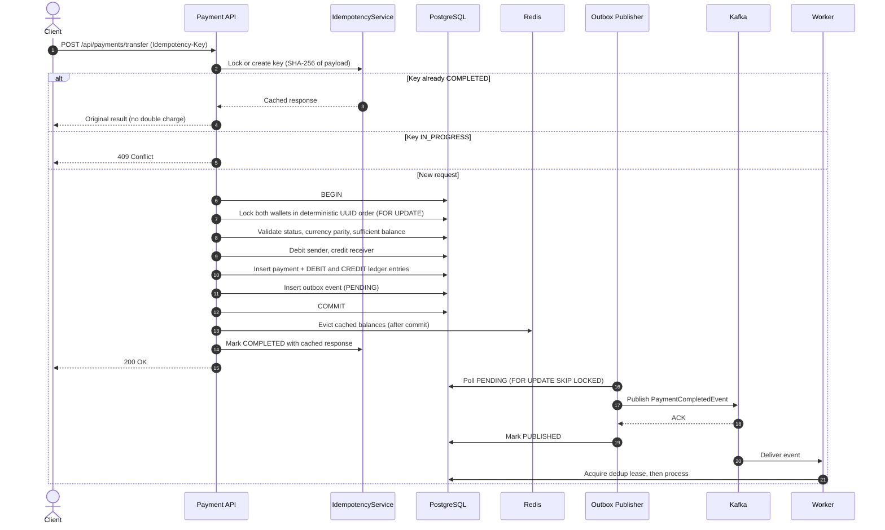
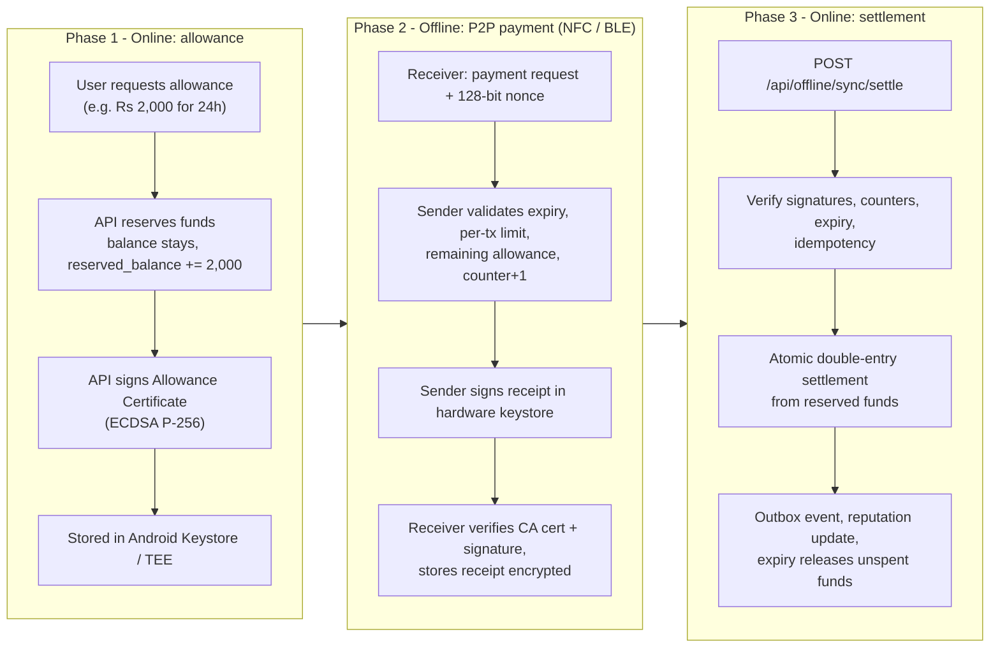
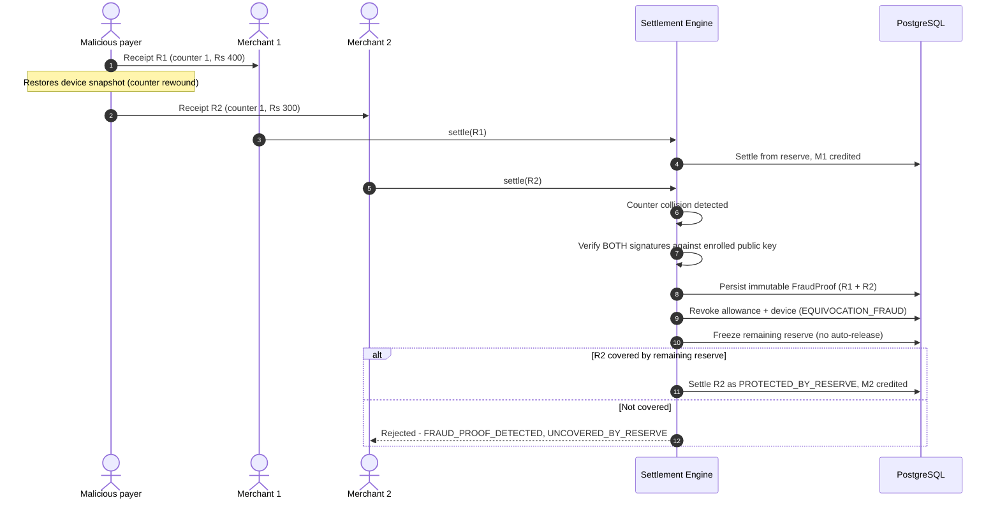
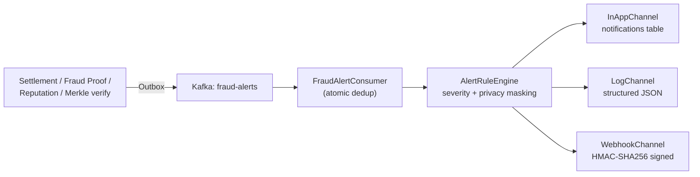
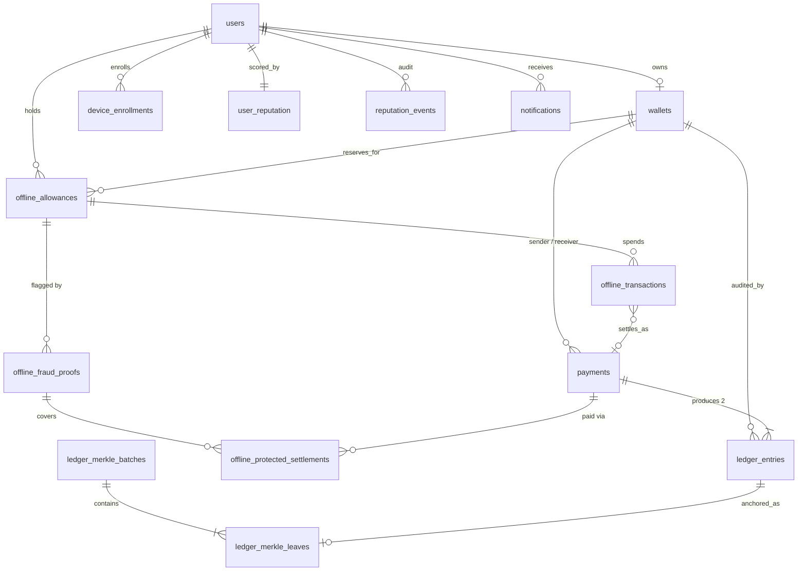

<div align="center">

# 💸 Monetra

### A distributed, fraud-resistant payment platform with an **offline wallet**, a **cryptographically verifiable ledger**, and production-grade observability

[](https://openjdk.org/projects/jdk/21/)
[](https://spring.io/projects/spring-boot)
[](https://www.postgresql.org/)
[](https://kafka.apache.org/)
[](https://redis.io/)
[](https://www.docker.com/)
[](https://aws.amazon.com/)
[](#-license)

</div>

> **Naming note:** the product is **Monetra**. The Maven modules and Java packages use the internal codename **PayFlow** (`payflow-api`, `com.payflow.*`, etc.). They refer to the same system.

---

## 📖 Table of Contents

1. [What Monetra Does](#-what-monetra-does)
2. [Key Capabilities](#-key-capabilities)
3. [System Architecture](#-system-architecture)
4. [Modules](#-modules)
5. [Core Payment Flow](#-core-payment-flow)
6. [Reliability Engineering Patterns](#-reliability-engineering-patterns)
7. [Offline Wallet](#-offline-wallet)
8. [Merkle-Tree Ledger Proofs](#-merkle-tree-ledger-proofs)
9. [Reconciliation Engine](#-reconciliation-engine)
10. [Fraud Alerts & Notifications](#-fraud-alerts--notifications)
11. [Data Model](#-data-model)
12. [Security](#-security)
13. [Observability](#-observability)
14. [Deployment & CI/CD](#-deployment--cicd)
15. [REST API Reference](#-rest-api-reference)
16. [Getting Started](#-getting-started)
17. [Testing](#-testing)
18. [Project Structure](#-project-structure)
19. [Engineering Trade-offs & Limitations](#-engineering-trade-offs--limitations)
20. [Production Audit](#-production-audit)
21. [Documentation Index](#-documentation-index)
22. [License](#-license) · [Author](#-author)

---

## 🎯 What Monetra Does

Monetra moves money between wallets **correctly, exactly once, and provably**, even when the network is slow, a server crashes mid-request, messages are delivered twice, or a user's phone has no signal at all.

| Problem in real payment systems | How Monetra solves it |
| :-- | :-- |
| Two transfers hit the same wallet at once and the balance goes negative | Pessimistic row locks (`SELECT … FOR UPDATE`) with **deterministic lock ordering** → no negative balances, no deadlocks |
| A client retries a request and the customer is charged twice | **Idempotency keys** with SHA-256 payload hashing and DB-enforced uniqueness |
| The database commits but the event never reaches Kafka (or vice-versa) | **Transactional Outbox** with `FOR UPDATE SKIP LOCKED` polling |
| Kafka delivers the same event twice | **Atomic consumer deduplication** via a `processed_events` lease |
| Someone edits or deletes historical ledger rows | **Immutability triggers** in PostgreSQL + **Merkle-tree proofs** (RFC 6962) anyone can verify |
| Money has to move with **no internet** (subway, rural, disaster zones) | **Offline wallet**: ECDSA-signed receipts over NFC/BLE, settled later with reserve-backed protection |
| A user double-spends offline | **Equivocation fraud proofs**, automatic device revocation, receiver protection from escrowed funds |
| Books silently drift out of balance | Independent **reconciliation engine** that audits ledger parity and Merkle integrity |
| "Is it healthy?" is a guess | Prometheus metrics, Grafana dashboards, structured JSON logs with correlation IDs |

---

## ✨ Key Capabilities

- **Double-entry ledger**: every transfer writes exactly one `DEBIT` and one `CREDIT`; amounts use `NUMERIC(19,4)`; `Σ debits = Σ credits` is continuously audited.
- **Atomic wallet-to-wallet transfers**: ACID, idempotent, currency-checked, with Redis-cached balance reads that never feed a write path.
- **Event-driven backbone**: Apache Kafka (KRaft) with `payment-events`, `payment-retry`, `payment-dlq`, and `fraud-alerts` topics; at-least-once delivery with exactly-once *effects*.
- **Offline P2P payments**: allowance certificates, hardware-keystore signing, monotonic counters, NFC/BLE protocol.
- **Fraud defense**: cryptographic double-spend proofs with an anti-framing guarantee, receiver-protected settlement, grace settlement, and reputation-based spending limits.
- **Tamper-evident ledger**: batched Merkle roots, hash-chained batches, public root endpoints, and an Android SDK that verifies inclusion proofs **without trusting the server**.
- **Multi-channel alerting**: in-app, structured-log, and HMAC-signed webhook channels with privacy masking.
- **Cloud-ready**: Docker Compose stack, Terraform for AWS (VPC, ALB, ECS Fargate, RDS, ElastiCache, Secrets Manager, CloudWatch), and GitHub Actions CI/CD.

---

## 🏗 System Architecture

### High-level view

```text
                     ┌──────────────────────────────────────────┐
                     │                 CLIENTS                  │
                     │  Web / REST clients   Android SDK        │
                     │                       (offline wallet,   │
                     │                        Merkle verifier)  │
                     └───────────────────┬──────────────────────┘
                                         │ HTTPS + JWT
                                         ▼
┌────────────────────────────────────────────────────────────────────────┐
│                           APPLICATION TIER                             │
│                                                                        │
│  ┌──────────────────────────────┐      ┌────────────────────────────┐  │
│  │ payflow-api  (:8080)         │      │ payflow-worker  (:8081)    │  │
│  │ Auth · Payments · Wallets    │      │ Kafka consumers            │  │
│  │ Offline settlement           │      │ Dedup · Retry · DLQ        │  │
│  │ Ledger proofs                │      │ Fraud alert routing        │  │
│  │ Reconciliation · Outbox      │      │                            │  │
│  └───────┬──────────┬───────────┘      └──────▲──────────┬──────────┘  │
│          │          │                         │          │             │
│          │          │     ┌───────────────────┴───────┐  │             │
│          │          │     │ payflow-core (shared lib) │  │             │
│          │          │     │ Domain · Repos · Events   │  │             │
│          │          │     │ Merkle (RFC 6962) · Logs  │  │             │
│          │          │     └───────────────────────────┘  │             │
└──────────┼──────────┼─────────────────────────┼──────────┼─────────────┘
           │          │                         │          │
           │          │ outbox poller           │ consume  │ read/write
           │          │ (SKIP LOCKED)           │          │
           │          ▼                         │          │
           │   ┌───────────────────────────────────┐       │
           │   │      APACHE KAFKA 3.7 (KRaft)     │       │
           │   │  payment-events   payment-retry   │       │
           │   │  payment-dlq      fraud-alerts    │       │
           │   └───────────────────────────────────┘       │
           │                                               │
           ▼                                               ▼
┌─────────────────────────┐                  ┌───────────────────────────┐
│  Redis 7                │                  │  PostgreSQL 16            │
│  Balance cache          │                  │  Ledger · Wallets         │
│  (cache-aside reads)    │                  │  Payments · Outbox        │
└─────────────────────────┘                  │  Offline tables           │
                                             └───────────────────────────┘

        api + worker ──/actuator/prometheus──▶ Prometheus ──▶ Grafana
```

### Architectural style

Monetra is a **modular monolith plus an async worker**. The API keeps the money-moving path (wallet debit, credit, ledger entries, and outbox event) inside **one PostgreSQL transaction**, avoiding distributed transactions and sagas for the critical path. Everything that can be eventual (notifications, alerts, retries) flows through Kafka to the worker.

| Layer | Responsibility |
| :-- | :-- |
| **Controllers** | REST endpoints, validation, role-based access (`@PreAuthorize`) |
| **Services** | Business rules: transfer execution, idempotency, offline settlement, reputation, reconciliation |
| **Security** | Stateless JWT filter chain, BCrypt hashing, correlation-ID filter |
| **Repositories** (`payflow-core`) | Spring Data JPA, locking queries, set-based aggregates |
| **Outbox & Messaging** | Reliable event publishing, retry and DLQ topology |
| **Persistence** | Flyway-versioned schema (9 migrations), DB-level constraints and immutability triggers |

---

## 🧩 Modules

| Module | Role | Highlights |
| :-- | :-- | :-- |
| **`payflow-core`** | Shared library | JPA entities and enums, repositories, domain events, custom exceptions, **RFC 6962 `MerkleTree` / `MerkleVerifier`**, `StructuredJsonLayout` (JSON logs with secret redaction) |
| **`payflow-api`** | Synchronous REST service (port `8080`) | Auth, wallets, payments, offline allowance & settlement, fraud proofs, reputation, ledger Merkle proofs, reconciliation, notifications, outbox publisher, Swagger UI |
| **`payflow-worker`** | Asynchronous consumers (port `8081`) | `PaymentEventConsumer`, `PaymentRetryConsumer`, `PaymentDlqConsumer`, `FraudAlertConsumer`, `AlertRuleEngine`, alert channels (in-app / log / webhook) |
| **`payflow-client-android`** | Client SDK (plain Java) | `P2PPaymentProtocol` (NFC/BLE), `SecureKeyStore`, `EncryptedOfflineStorage`, `OfflineSyncClient`, `OfflineFraudProofVerifier`, `MerkleVerifier` |

Supporting directories: `docker/` (Dockerfiles, `.env.example`), `monitoring/` (Prometheus + Grafana provisioning), `deploy/aws/` (Terraform + ECS task definitions), `.github/workflows/` (CI and AWS deploy), `docs/` (deep-dive design documents).

---

## 🔄 Core Payment Flow



---

## 🛡 Reliability Engineering Patterns

### 1. Deadlock-free concurrency
If Alice→Bob and Bob→Alice run simultaneously, naive locking deadlocks. Monetra always locks wallets in **ascending UUID order** regardless of transfer direction, so every thread acquires locks in the same sequence, making circular waits impossible.

```java
UUID first  = senderId.compareTo(receiverId) < 0 ? senderId : receiverId;
UUID second = senderId.compareTo(receiverId) < 0 ? receiverId : senderId;
Wallet w1 = walletRepository.findByIdForUpdate(first).orElseThrow(...);
Wallet w2 = walletRepository.findByIdForUpdate(second).orElseThrow(...);
```

Database `CHECK` constraints (`balance >= 0`, `balance >= reserved_balance`, `amount > 0`) are the last line of defense.

### 2. Idempotency
- The `Idempotency-Key` header is mandatory for transfers.
- Request bodies are hashed (SHA-256); the same key with a different payload is rejected.
- States: `IN_PROGRESS → COMPLETED | FAILED`. Failed responses replay with their **original HTTP status**.
- **Lease timeout recovery**: an `IN_PROGRESS` key abandoned by a crashed node is recovered, not locked forever.

### 3. Transactional Outbox
The business change **and** its event row commit atomically. A scheduler (every 2 s) claims `PENDING` rows with `FOR UPDATE SKIP LOCKED`, waits for broker acknowledgement, and only then marks them `PUBLISHED`. Multiple API instances can poll concurrently with no duplicate publishing and no lock contention.

### 4. Consumer deduplication, retry, and DLQ
- Kafka is at-least-once, so the worker **acquires a lease** by inserting `(event_id, consumer_group)` into `processed_events` *before* running side effects; a primary-key collision means "already handled".
- Failures go to `payment-retry` (bounded backoff), and exhausted retries land in `payment-dlq`, which raises a critical alert.
- Manual acknowledgements ensure offsets only advance after success.

### 5. Cache correctness
Balance reads use Redis cache-aside (10-minute TTL). Eviction happens in an **`afterCommit` hook**, so a concurrent reader can never re-cache an uncommitted value. Money-moving code never reads from Redis.

### 6. Database-level immutability
PostgreSQL triggers reject `UPDATE`/`DELETE` on `ledger_entries`, fraud proofs, reputation events, and Merkle batches/leaves, so history stays append-only even against an errant script.

---

## 📴 Offline Wallet

Monetra lets two phones exchange money with **no internet connection at all**: in a subway, on a flight, or in a disaster zone. This is the hardest problem in the system, because there is no central authority at the point of sale.

> **Honest security stance:** on a rooted device, offline double-spending cannot be *prevented* with mathematical certainty. Monetra instead makes it **detectable, attributable, and strictly bounded in loss**.

### Three phases



### Cryptography
No home-grown crypto; only standard primitives:

| Item | Choice |
| :-- | :-- |
| Signatures | **ECDSA, NIST P-256 (`secp256r1`), SHA-256** |
| Key custody | Android Keystore (**TEE / StrongBox**) |
| Nonces | 128-bit from `SecureRandom` |
| Allowance Certificate | `AllowanceID ‖ WalletID ‖ DeviceID ‖ AllocatedAmount ‖ MaxSingleTx ‖ ExpiresAt` signed by the Monetra authority key |
| Signed Receipt | `TxID ‖ AllowanceID ‖ SenderWalletID ‖ ReceiverWalletID ‖ Amount ‖ Currency ‖ Counter ‖ Nonce` signed by the sender's device key |

### Settlement rules
1. **Idempotent**: a `TxID` already settled returns its original confirmation.
2. **Monotonic counter**: replayed or rewound counters are rejected.
3. **Cumulative cap**: `spent + amount ≤ allocated`.
4. **Atomic ledger write**: sender `reserved_balance` and `balance` decrease, receiver balance increases, a `DEBIT` and a `CREDIT` entry are written, and an outbox event is emitted, all in one transaction.
5. **Expiry**: unspent reserved funds are released back to available balance.

### Equivocation detection (double-spend fraud proofs)

When one device signs **two different receipts for the same counter**, the backend detects the collision at settlement time.



**Anti-framing guarantee:** a fraud proof is created **only if both signatures verify** under the enrolled device key. A merchant who fabricates a receipt can never frame an innocent payer.

**Receiver protection:** honest merchants are paid out of the cheater's **escrowed reserve** whenever limits and reserve allow it (`PROTECTED_BY_RESERVE`). Receipts accepted before revocation can also settle under `GRACE_SETTLEMENT`. Devices revoked for loss/theft or by an admin are strictly rejected.

### Reputation-based limits
Offline limits scale with an explainable, append-only trust score.

| Tier | Min score | Max allowance | Max single tx |
| :-- | --: | --: | --: |
| `RESTRICTED` | n/a | ₹0 | ₹0 |
| `NEW` | 0 | ₹500 | ₹200 |
| `BRONZE` | 200 | ₹1,000 | ₹300 |
| `SILVER` | 500 | ₹1,500 | ₹400 |
| `GOLD` | 1000 | ₹2,000 | ₹500 |

Defaults: starting score **100**, **+5** per clean receipt, **+20** allowance-completion bonus, **−10** per rejection, **−100** for fraud; daily gain cap **50**; **15-point hysteresis** to stop tier flapping; global ceilings ₹2,000 / ₹500. Anti-gaming: self-dealing (wash trades) earns **0 points**, and promotion above `NEW` requires **≥ 7 days** account age and **≥ 3 distinct counterparties**. Over-limit requests return **HTTP 422**.

### Threat model (summary)

| Threat | Defense |
| :-- | :-- |
| Replay of a receipt | Unique `TxID` and `(allowance_id, counter)` constraints; idempotent re-settlement |
| Forged allowance | Receiver verifies the authority's ECDSA signature |
| Counter rewind / skip | Strict monotonic counter checks |
| Framing by a colluding receiver | Both-signatures-must-verify rule |
| Dropped connection mid-sync | Per-item idempotent batch settlement |
| Stolen device | Biometric-gated keystore + `POST /api/offline/devices/revoke` |
| Snapshot-restore double-spend | Fraud proof + auto-revocation + escrow + capped exposure |

Full detail: [`docs/OFFLINE_WALLET_DESIGN.md`](docs/OFFLINE_WALLET_DESIGN.md).

---

## 🌳 Merkle-Tree Ledger Proofs

A relational database can enforce constraints, but it cannot **prove** to an outsider that history wasn't altered. Monetra seals its ledger with a Merkle tree modeled on **RFC 6962 (Certificate Transparency)**.

- **Canonical entry format:** `entryId|paymentId|walletId|entryType|amount|balanceAfter|createdAtEpochMicros`
- **Domain separation:** `leaf = SHA256(0x00 ‖ entry)`, `node = SHA256(0x01 ‖ left ‖ right)` (defeats second-preimage attacks)
- **Any batch size:** deterministic power-of-two splitting, with no padding and O(log n) proofs
- **Hash-chained batches:** `chain_hash = SHA256(prev_root ‖ root ‖ batch_no ‖ leaf_count)`, starting from a 64-zero genesis root
- **Single-writer batching:** `LedgerMerkleBatchBuilder` runs every 60 s under a PostgreSQL **advisory lock**, with a 60 s lag window so in-flight commits are never missed
- **Immutable by trigger:** batches and leaves reject `UPDATE`/`DELETE`
- **Zero-trust clients:** the Android SDK ships a framework-free `MerkleVerifier`, so a phone can verify its own transaction inclusion against public roots

```text
                    ┌──────────────────────┐
                    │  Root hash (0x01)    │
                    └─────────┬────────────┘
                 ┌────────────┴─────────────┐
                 ▼                          ▼
        ┌─────────────────┐         ┌───────────────┐
        │ Node 0-1 (0x01) │         │ Leaf 2 (0x00) │
        └───────┬─────────┘         └───────────────┘
          ┌─────┴──────┐
          ▼            ▼
   ┌─────────────┐ ┌─────────────┐
   │ Leaf 0      │ │ Leaf 1      │
   │ (0x00)      │ │ (0x00)      │
   └─────────────┘ └─────────────┘
                     ▲
                     └── sibling in the proof for Leaf 0
```

**What it proves:** inclusion, immutability, ordering and non-omission, and timeline continuity.
**What it does *not* prove:** balance sufficiency at execution time (that's the job of row locks and constraints), external rail settlement, or protection against offline device snapshot restores.

Reference: [`docs/LEDGER_PROOFS.md`](docs/LEDGER_PROOFS.md).

---

## 🧮 Reconciliation Engine

`ReconciliationService` is an independent auditor that **never mutates financial history**. It writes findings to `reconciliation_reports`.

- ✅ **Ledger parity:** `Σ DEBIT == Σ CREDIT` system-wide
- ✅ **Wallet integrity:** no negative balances
- ✅ **Payment completeness:** every `COMPLETED` payment has exactly one debit and one credit matching its amount
- ✅ **Merkle integrity:** recomputes recent batch roots, chain hashes, and chain linkage; on failure emits `LEDGER_ROOT_VERIFICATION_FAILED` (CRITICAL alert)
- ⚡ **Set-based SQL:** one `GROUP BY` aggregate instead of O(N) per-wallet queries

---

## 🚨 Fraud Alerts & Notifications



| Trigger | Recipient | Severity |
| :-- | :-- | :-- |
| Offline fraud proof detected | Admins (full detail) | **CRITICAL** |
| Offline fraud proof detected | Device owner (masked device id) | **HIGH** |
| Receiver-protected receipt settled | Receiver (sender keys stripped) | **INFO** |
| Receipt uncovered by reserve | Receiver and admins | **HIGH** |
| Reputation tier → `RESTRICTED` | User | **HIGH** |
| Merkle root verification failed | Admins | **CRITICAL** |

The in-app channel enforces a unique `(event_id, type, recipient)` constraint, so redelivered events never create duplicate notifications. Webhooks carry an `X-PayFlow-Signature: sha256=<hex>` header and use retries with a circuit breaker.

---

## 🗄 Data Model

Nineteen tables across nine Flyway migrations (`V1`–`V9`).

| Migration | Adds |
| :-- | :-- |
| `V1` | `users`, `wallets`, `payments`, `ledger_entries`, `idempotency_keys`, `outbox_events`, `processed_events`, `reconciliation_reports` |
| `V2` | Indexes and constraints |
| `V3` | Immutability and audit triggers |
| `V4` | `device_enrollments`, `offline_allowances`, `offline_transactions`, `wallets.reserved_balance` |
| `V5` | `offline_fraud_proofs` |
| `V6` | `offline_protected_settlements`, `offline_rejected_receipts` |
| `V7` | `user_reputation`, `reputation_events` |
| `V8` | `notifications` |
| `V9` | `ledger_merkle_batches`, `ledger_merkle_leaves` |



Key invariants enforced in the database: `balance >= 0`, `reserved_balance >= 0`, `balance >= reserved_balance`, `amount > 0`, and unique `(allowance_id, counter)` on offline transactions.

---

## 🔐 Security

- **Authentication:** stateless **JWT** (JJWT 0.12.5), 24-hour default expiry, `BCrypt` (strength 12)
- **Authorization:** role-based (`ROLE_USER`, `ROLE_ADMIN`) with `@PreAuthorize`; ownership checks on wallet, notification, and proof access
- **Crypto:** ECDSA P-256 / SHA-256, hardware-backed keys on Android, no custom algorithms
- **Log hygiene:** automatic redaction of JWTs, passwords, secrets, PINs, and CVVs; sensitive MDC keys masked
- **Transport and secrets (AWS):** TLS to RDS, Redis, and Kafka; credentials injected from **AWS Secrets Manager** at task start, never baked into images
- **Webhook authenticity:** HMAC-SHA256 request signatures

> ⚠️ **Before any real deployment:** `application.yml` contains a development fallback for `APP_JWT_SECRET`. **Always override it** with a strong random secret via environment variable or Secrets Manager.

---

## 📊 Observability

| Pillar | Implementation |
| :-- | :-- |
| **Metrics** | Micrometer → `/actuator/prometheus`, scraped every 5 s |
| **Dashboards** | Auto-provisioned Grafana dashboard `payflow-overview` |
| **Health** | Custom `DistributedInfraHealthIndicator` probes PostgreSQL, Redis, and Kafka with latency |
| **Logs** | Structured JSON; `X-Correlation-ID` propagated from HTTP through Kafka into the worker |
| **Alerts** | Recommended Prometheus rules (failure rate, outbox backlog, pool saturation, reconciliation discrepancy) |

Notable metrics: `payflow.payments.{total,success,failure,latency}`, `payflow.idempotency.conflicts`, `payflow.outbox.pending.count`, `payflow.outbox.publishing.failures`, `payflow.kafka.consumer.lag`, `payflow.redis.cache.{hits,misses}`, `payflow.database.pool.utilization`, `payflow.reconciliation.failures` (**must always be 0**), plus `alerts_created_total` and `ledger_merkle_verify_failures_total`.

Guide: [`docs/OBSERVABILITY.md`](docs/OBSERVABILITY.md).

---

## ☁️ Deployment & CI/CD

### Local stack (Docker Compose)

| Service | Port |
| :-- | :-- |
| `payflow-api` | 8080 |
| `payflow-worker` | 8081 |
| PostgreSQL 16 | 5432 |
| Redis 7 | 6379 |
| Kafka 3.7 (KRaft) | 9092 / 9094 |
| Prometheus | 9090 |
| Grafana | 3000 |

### AWS (Terraform in `deploy/aws/terraform/`)

```text
                  Users & Mobile Clients
                           │
                           ▼
             ┌───────────────────────────┐
             │ Application Load Balancer │   (public subnets)
             └─────────────┬─────────────┘
                           │  /actuator/health
┌──────────────────────────┼───────────────────────────────────────┐
│ VPC (2 AZs)              ▼                                       │
│   ┌────────────────────────────────────────────┐                 │
│   │ Private subnets: ECS Fargate               │                 │
│   │   payflow-api task    payflow-worker task  │                 │
│   └──────┬───────────────────────┬─────────────┘                 │
│          │                       │                               │
│   ┌──────▼───────────────────────▼─────────────┐                 │
│   │ Isolated data subnets                      │                 │
│   │   RDS PostgreSQL 16                        │                 │
│   │   ElastiCache Redis 7                      │                 │
│   │   Kafka (MSK / Confluent)                  │                 │
│   └────────────────────────────────────────────┘                 │
└──────────────────────────────────────────────────────────────────┘

   Secrets Manager ··> api / worker    (credentials at task start)
   CloudWatch Logs ··> api / worker    (logs)
   ECR             ··> ECS tasks       (images)
```

- **IaC:** VPC, security groups, ALB, ECS, RDS, ElastiCache, Secrets Manager, and CloudWatch, each in its own `.tf` file, with a `portfolio_mode` switch for low-cost deployments
- **Migrations:** Flyway is disabled inside long-running API tasks and run as a **one-shot ECS task** before rollout, which avoids multi-replica migration races
- **Graceful shutdown:** 30 s per phase, so in-flight payments finish before a container stops

### GitHub Actions
- **`ci.yml`**: on push/PR, spins up PostgreSQL and Redis services, runs `mvn clean verify` on JDK 21 (Temurin), and uploads Surefire reports.
- **`deploy-aws.yml`**: build and test → build and push images to ECR → run the Flyway migration task → render and deploy ECS task definitions (API, then worker), authenticating through **AWS OIDC** (no long-lived keys).

Guide: [`docs/AWS_DEPLOYMENT_GUIDE.md`](docs/AWS_DEPLOYMENT_GUIDE.md).

---

## 📡 REST API Reference

Interactive docs: **http://localhost:8080/swagger-ui.html** (Bearer JWT supported).

| Area | Method & path | Access | Purpose |
| :-- | :-- | :-- | :-- |
| **Auth** | `POST /api/auth/register` | Public | Register a user and provision a wallet |
| | `POST /api/auth/login` | Public | Obtain a JWT |
| **Wallets** | `POST /api/wallets` | User | Create an additional wallet |
| | `GET /api/wallets/me` | User | Current wallet |
| | `GET /api/wallets/me/balance` | User | Balance (Redis cache-aside) |
| | `GET /api/wallets/me/transactions` | User | Paginated ledger entries |
| **Payments** | `POST /api/payments/transfer` | User | Atomic transfer (**`Idempotency-Key` required**) |
| | `GET /api/payments/{paymentId}` | User | Payment details |
| | `GET /api/payments/history` | User | Payment history |
| **Offline devices** | `POST /api/offline/devices/enroll` | User | Enroll a device public key |
| | `POST /api/offline/devices/revoke` | User | Revoke a lost/stolen device |
| **Offline allowance** | `POST /api/offline/allowance/allocate` | User | Reserve funds and receive a signed certificate |
| | `GET /api/offline/allowance/active` | User | Active allowance |
| | `POST /api/offline/allowance/{allowanceId}/release` | User | Release unspent reserve |
| **Offline settlement** | `POST /api/offline/sync/settle` | User | Submit signed receipts for settlement |
| **Reputation** | `GET /api/offline/reputation/me` | User | Own score and tier |
| | `GET /api/admin/offline/reputation/{userId}` | Admin | Score and event trail |
| | `POST /api/admin/offline/reputation/{userId}/override` | Admin | Manual score/restriction override |
| **Fraud proofs** | `GET /api/admin/offline/fraud-proofs` | Admin | List (filter by status) |
| | `GET /api/admin/offline/fraud-proofs/{id}` | Admin | Proof detail |
| | `GET /api/admin/offline/fraud-proofs/{id}/verify` | Admin | Independently re-verify both signatures |
| | `POST /api/admin/offline/fraud-proofs/{id}/review` | Admin | Confirm or dismiss |
| **Ledger proofs** | `GET /api/ledger/entries/{entryId}/proof` | Owner / Admin | Merkle inclusion proof |
| | `GET /api/public/ledger/roots` | Public | Paged committed batch roots |
| | `GET /api/public/ledger/roots/latest` | Public | Latest root |
| | `POST /api/admin/ledger/batches/{batchNumber}/verify` | Admin | Recompute root and chain |
| **Reconciliation** | `POST /api/admin/reconciliation/run` | Admin | Run an audit |
| | `GET /api/admin/reconciliation/reports` | Admin | Report history |
| **Notifications** | `GET /api/notifications?unreadOnly=true` | User | In-app notifications |
| | `POST /api/notifications/{id}/read` | User | Mark as read |
| | `GET /api/admin/alerts` | Admin | Alerts by severity/type/status |

### Quick example

```bash
# Register two users
curl -X POST http://localhost:8080/api/auth/register \
  -H "Content-Type: application/json" \
  -d '{"username":"alice","email":"alice@example.com","password":"Password123!","initialDeposit":10000.00}'

# Idempotent transfer
curl -X POST http://localhost:8080/api/payments/transfer \
  -H "Authorization: Bearer <ALICE_JWT>" \
  -H "Idempotency-Key: pay-tx-001" \
  -H "Content-Type: application/json" \
  -d '{"senderWalletId":"<ALICE_WALLET>","receiverWalletId":"<BOB_WALLET>","amount":3000.00,"currency":"INR"}'

# Re-send the exact same request: you get the original response, never a second charge.

# Get a Merkle inclusion proof for one of your ledger entries
curl http://localhost:8080/api/ledger/entries/<ENTRY_ID>/proof \
  -H "Authorization: Bearer <ALICE_JWT>"
```

---

## 🚀 Getting Started

### Prerequisites
- Java **21**
- Maven **3.9+**
- Docker and Docker Compose

### Run everything with Docker Compose

```bash
git clone https://github.com/tanusingh04/Monetra.git
cd Monetra

# (optional) review environment defaults
cat docker/.env.example

docker compose up --build -d
docker compose ps          # wait for all services to be healthy
```

| URL | What |
| :-- | :-- |
| http://localhost:8080/swagger-ui.html | API explorer |
| http://localhost:8080/actuator/health | Health incl. PostgreSQL / Redis / Kafka |
| http://localhost:9090 | Prometheus |
| http://localhost:3000 | Grafana (dashboard auto-provisioned) |

### Develop locally

```bash
# 1. Start only the infrastructure
docker compose up -d postgres redis kafka

# 2. Run the API
mvn spring-boot:run -pl payflow-api

# 3. In another terminal, run the worker
mvn spring-boot:run -pl payflow-worker
```

### Key configuration

| Variable | Purpose |
| :-- | :-- |
| `APP_JWT_SECRET` | JWT signing secret (**must override outside local dev**) |
| `APP_JWT_EXPIRATION_MS` | Token lifetime (default 24 h) |
| `SPRING_DATASOURCE_*` | PostgreSQL connection |
| `SPRING_DATA_REDIS_*` | Redis connection |
| `SPRING_PROFILES_ACTIVE=prod` | Production profile (TLS, tuned pools, Flyway off) |

---

## 🧪 Testing

The suite contains roughly **120+ tests** across unit, integration, and concurrency layers (JUnit 5, Mockito, Testcontainers).

```bash
mvn clean test                 # everything
mvn clean verify -B            # what CI runs

# The headline concurrency test: parallel ₹800 withdrawals from a ₹1,000 wallet
mvn test -Dtest=ConcurrentTransferIntegrationTest -Dsurefire.failIfNoSpecifiedTests=false
```

Coverage highlights:

- **Concurrency:** simultaneous transfers never overdraw
- **Idempotency & outbox:** `IdempotencyServiceTest`, `OutboxPublisherServiceTest`
- **Offline:** crypto, allowance, settlement, fraud proofs, receiver-protected settlement, reputation (unit and integration)
- **Merkle:** tree, batch builder, and end-to-end integration; Android verifier parity
- **Worker:** consumers, alert rule engine, webhook channel
- **Android SDK:** P2P protocol, fraud-proof verifier, Merkle verifier

---

## 📁 Project Structure

```
Monetra/
├── pom.xml                          # Parent POM (Java 21, Spring Boot 3.3.4)
├── docker-compose.yml               # Postgres · Redis · Kafka · API · Worker · Prometheus · Grafana
├── docker/                          # Dockerfile.api, Dockerfile.worker, .env.example
├── payflow-core/                    # Shared library
│   └── src/main/java/com/payflow/core/
│       ├── domain/                  # user, wallet, payment, ledger, outbox, idempotency,
│       │                            # offline, reputation, notification, merkle, reconciliation
│       ├── repository/              # Spring Data JPA repositories
│       ├── event/                   # Domain events (payment, fraud, reputation, ledger root)
│       ├── merkle/                  # RFC 6962 MerkleTree / Verifier / Proof
│       ├── exception/               # Business exceptions
│       └── logging/                 # StructuredJsonLayout (JSON + redaction)
├── payflow-api/                     # REST service
│   └── src/main/
│       ├── java/com/payflow/api/
│       │   ├── controller/          # REST endpoints
│       │   ├── service/             # Payments, idempotency, outbox, reconciliation
│       │   │   └── offline/         # Allowance, settlement, crypto, fraud proofs, reputation
│       │   ├── merkle/              # Batch builder, anchoring
│       │   ├── security/            # JWT, filters, user principal
│       │   ├── config/              # Kafka, Redis, Security, OpenAPI
│       │   ├── metrics/ · health/   # Micrometer + health indicator
│       │   └── dto/
│       └── resources/db/migration/  # V1…V9 Flyway migrations
├── payflow-worker/                  # Kafka consumers
│   └── src/main/java/com/payflow/worker/
│       ├── consumer/                # Event, Retry, DLQ, FraudAlert consumers
│       ├── alert/                   # AlertRuleEngine + in-app / log / webhook channels
│       └── service/                 # Deduplication, event processing
├── payflow-client-android/          # Mobile SDK
│   └── src/main/java/com/payflow/android/
│       ├── p2p/ · crypto/ · storage/ · sync/ · fraud/ · merkle/ · model/
├── monitoring/                      # Prometheus config, Grafana dashboards & provisioning
├── deploy/aws/                      # Terraform + ECS task definitions
├── .github/workflows/               # ci.yml, deploy-aws.yml
└── docs/                            # Design and operations deep dives
```

---

## ⚖️ Engineering Trade-offs & Limitations

| Decision | Trade-off | Why |
| :-- | :-- | :-- |
| **Pessimistic locking** | More contention on a single hot wallet | Avoids abort-and-retry storms; deterministic ordering favors correctness in financial flows |
| **Outbox polling (2 s) instead of CDC** | Small query overhead and up to ~2 s event latency | Simpler than Debezium/Kafka Connect and scales horizontally via `SKIP LOCKED` |
| **Modular monolith core** | Shared schema across modules | One ACID commit for debit + credit + ledger + outbox, with no 2PC or sagas |
| **Redis cache-aside balances** | Brief staleness possible | 10-min TTL, post-commit eviction, and writes never read the cache |
| **Offline double-spend** | Cannot be *prevented* in software on rooted devices | Made detectable, attributable, reserve-backed, and bounded by tier caps |

**Current scope limits**
- Single-currency per transfer; **cross-currency transfers are rejected** (no FX engine).
- Settlement is **internal ledger only**; no external rail (UPI/ACH/Fedwire) integration.
- Merkle roots are anchored to the application log (`LogRootAnchorPublisher`); a public-chain or external transparency-log anchor is a natural extension via the `RootAnchorPublisher` interface.
- The Android module is a **protocol/crypto SDK**, not a full mobile app UI.

---

## 🔎 Production Audit

A forensic review of the codebase identified **10 issues (1 critical, 5 high, 3 medium, 1 low)**; all have been fixed and covered by tests. Highlights:

| ID | Severity | Issue fixed |
| :-- | :-- | :-- |
| AUD-01 | Critical | Outbox publisher released locks before Kafka ACK → duplicate publishes |
| AUD-02 | High | Redis eviction before DB commit → stale cached balances |
| AUD-03 | High | Missing currency parity check in transfers |
| AUD-04 | High | Retried failed idempotent requests crashed with HTTP 500 |
| AUD-05 | High | Check-then-act race in consumer deduplication |
| AUD-06 | High | Retry consumer was mocked and blocked the listener thread |
| AUD-07 | Medium | Idempotency keys stuck `IN_PROGRESS` after a node crash |
| AUD-08 | Medium | O(N) query cascade in reconciliation |
| AUD-09 | Medium | No DB-level immutability on ledger entries |
| AUD-10 | Low | No graceful shutdown configured |

Full report: [`docs/PRODUCTION_AUDIT.md`](docs/PRODUCTION_AUDIT.md).

---

## 📚 Documentation Index

| Document | Covers |
| :-- | :-- |
| [`docs/OFFLINE_WALLET_DESIGN.md`](docs/OFFLINE_WALLET_DESIGN.md) | Offline protocol, cryptography, fraud proofs, reputation, alerting, threat model |
| [`docs/LEDGER_PROOFS.md`](docs/LEDGER_PROOFS.md) | RFC 6962 Merkle ledger, proof format, verification, guarantees |
| [`docs/OBSERVABILITY.md`](docs/OBSERVABILITY.md) | Metrics catalog, health checks, logging, Grafana, alert rules |
| [`docs/AWS_DEPLOYMENT_GUIDE.md`](docs/AWS_DEPLOYMENT_GUIDE.md) | AWS architecture, Terraform, secrets, migrations, cost tiers |
| [`docs/PRODUCTION_AUDIT.md`](docs/PRODUCTION_AUDIT.md) | Findings and fixes |

---

## 📄 License

Released under the **Apache License 2.0**.

## 👩‍💻 Author

**Tanu Singh**, [@tanusingh04](https://github.com/tanusingh04)

<div align="center">

⭐ If Monetra helped you learn something about building trustworthy payment systems, consider starring the repo.

</div>
