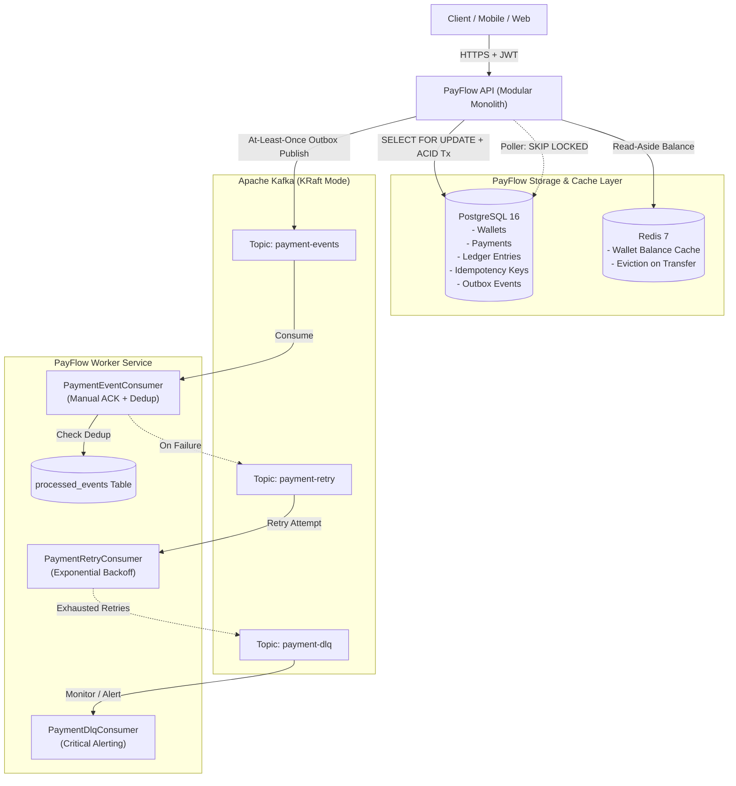
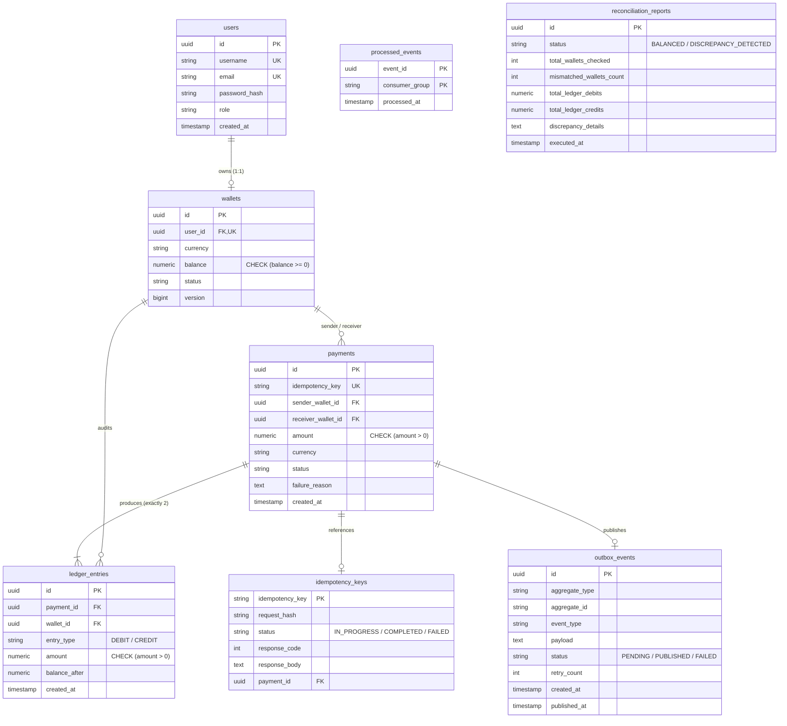
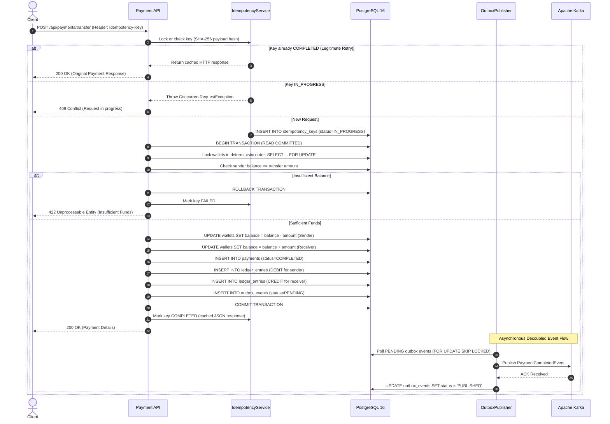

# PayFlow – Distributed Payment Processing Engine

[](https://openjdk.org/projects/jdk/21/)
[](https://spring.io/projects/spring-boot)
[](https://www.postgresql.org/)
[](https://kafka.apache.org/)
[](https://redis.io/)
[](LICENSE)

## 1. Project Overview

**PayFlow** is an enterprise-grade distributed payment processing platform engineered for high-concurrency financial operations. It is designed to demonstrate mission-critical backend engineering standards required by Tier-1 fintech platforms and global payment networks.

Unlike basic CRUD systems, PayFlow solves fundamental distributed systems challenges:
* **Financial Accuracy**: Strict immutable double-entry bookkeeping (`NUMERIC(19, 4)` precision) where credits and debits always balance.
* **Database Concurrency & Deadlock Freedom**: Pessimistic write locking (`SELECT FOR UPDATE`) combined with **deterministic lexicographical lock ordering**, guaranteeing that simultaneous transactions between the same wallets never deadlock and balances never become negative.
* **Idempotency Guarantees**: Header-driven (`Idempotency-Key`) deduplication backed by cryptographic SHA-256 payload hashing and PostgreSQL atomic unique constraints.
* **Dual-Write Prevention**: Asynchronous domain messaging using the **Transactional Outbox Pattern** with PostgreSQL `SKIP LOCKED` batch polling, decoupling relational database transactions from Apache Kafka brokers.
* **Application-Level Consumer Deduplication**: Message consumers that guarantee idempotent processing regardless of Kafka message re-deliveries.
* **Automated Reconciliation**: Multi-way financial auditing that verifies ledger parity, wallet balance integrity, and payment record completeness.

## 2. System Architecture

PayFlow employs a **modular monolith** for synchronous API processing (`payflow-api`), paired with an asynchronous **event worker service** (`payflow-worker`) and a shared domain module (`payflow-core`).



## 3. Technology Stack

| Component | Technology | Rationale |
| : | : | : |
| **Language** | Java 21 (LTS) | Virtual threads, record types, pattern matching, enhanced security. |
| **Framework** | Spring Boot 3.3.4 | Cloud-native dependency injection, declarative transactions, actuator metrics. |
| **Security** | Spring Security 6 & JJWT 0.12.5 | Stateless Bearer token verification, BCrypt password hashing (strength 12), RBAC. |
| **ORM & Data** | Spring Data JPA / Hibernate | Object-relational mapping, pessimistic locking (`LockModeType.PESSIMISTIC_WRITE`). |
| **Database** | PostgreSQL 16 | ACID compliance, `FOR UPDATE SKIP LOCKED`, row-level check constraints. |
| **Database Migrations** | Flyway 10.10 | Version-controlled, immutable schema migrations (`V1`, `V2`). |
| **Event Streaming** | Apache Kafka 3.7.0 (KRaft) | High-throughput distributed event broker without Zookeeper overhead. |
| **Caching** | Redis 7 & Spring Data Redis (Lettuce) | Low-latency read-aside caching with TTL and transactional eviction. |
| **API Documentation** | Springdoc OpenAPI 2.5 (Swagger UI) | Interactive API exploration with Bearer JWT integration. |
| **Containerization** | Docker & Docker Compose | Multi-container reproducible production stack with health checks. |
| **Testing** | JUnit 5, Mockito, Testcontainers | Unit tests, multi-threaded concurrency suites, integration slice tests. |

## 4. Database Schema and Relationships

All financial amounts are modeled with `NUMERIC(19, 4)`. Absolute balance bounds are guarded by storage-layer check constraints.



## 5. Payment Lifecycle



## 6. Concurrency Handling & Deadlock Prevention

### The Deadlock Threat
When User A transfers to User B at the same millisecond that User B transfers to User A:
* Thread 1 acquires lock on Wallet A, waits for Wallet B.
* Thread 2 acquires lock on Wallet B, waits for Wallet A.
* **Result**: Cyclical dependency (`DeadlockDetectedException`).

### Deterministic Lexicographical Lock Ordering
PayFlow eliminates deadlocks mathematically by ordering lock acquisition on wallet UUIDs:
```java
UUID firstLockId = senderId.compareTo(receiverId) < 0 ? senderId : receiverId;
UUID secondLockId = senderId.compareTo(receiverId) < 0 ? receiverId : senderId;

// Both threads acquire locks in the identical order regardless of transfer direction:
Wallet firstWallet = walletRepository.findByIdForUpdate(firstLockId)
        .orElseThrow(() -> new ResourceNotFoundException("Wallet not found: " + firstLockId));
Wallet secondWallet = walletRepository.findByIdForUpdate(secondLockId)
        .orElseThrow(() -> new ResourceNotFoundException("Wallet not found: " + secondLockId));

Wallet senderWallet = firstWallet.getId().equals(senderId) ? firstWallet : secondWallet;
Wallet receiverWallet = firstWallet.getId().equals(receiverId) ? firstWallet : secondWallet;
```

## 7. Transactional Outbox Pattern

### Dual-Write Problem
Updating the database and publishing to Kafka in the same block without the Outbox pattern leads to inconsistencies:
* If database commits but Kafka is down: Event is lost forever.
* If Kafka publishes but database rolls back: Phantom event dispatched downstream.

### PayFlow Outbox Solution
1. In the **exact same database transaction**, the wallet updates, ledger records, and domain event (`outbox_events` record) are committed atomically.
2. An asynchronous scheduler polls unpublished events using:
   ```sql
   SELECT * FROM outbox_events 
   WHERE status = 'PENDING' 
   ORDER BY created_at ASC 
   LIMIT :limit 
   FOR UPDATE SKIP LOCKED;
   ```
3. `SKIP LOCKED` ensures horizontal scaling where multiple API/worker instances poll concurrently without lock contention or duplicate publishing.
4. Events are marked `PUBLISHED` only after Kafka acknowledges receipt (`whenComplete`).

## 8. Consumer Idempotency & Fault Tolerance

Distributed message brokers offer **at-least-once** delivery guarantees. Network blips, broker failovers, or rebalances can cause a consumer to receive duplicate events.

PayFlow avoids duplicate processing using application-level deduplication:
1. Every event has a unique `eventId` (UUID).
2. Before executing side effects, `PaymentEventConsumer` checks `processed_events` table for `(eventId, consumerGroup)`.
3. If already present:
   ```java
   log.warn("Application Deduplication: Event {} already processed. Acknowledging.", event.eventId());
   acknowledgment.acknowledge();
   return;
   ```
4. If novel: processes downstream logic, writes to `processed_events`, and calls `acknowledgment.acknowledge()`.
5. On unrecoverable consumer errors, messages are routed to `payment-retry` with exponential backoff before landing in `payment-dlq`.

## 9. Reconciliation Engine

The reconciliation module (`ReconciliationService`) operates as an independent financial auditor:
* **Ledger Parity**: Asserts `SUM(DEBIT) == SUM(CREDIT)` across the entire system.
* **Wallet Balance Audit**: Verifies that no wallet contains an illegal negative balance.
* **Payment Consistency**: Validates that every `COMPLETED` payment has exactly two entries: one debit and one credit with amounts matching the payment.
* **Non-Destructive**: Reports findings in `reconciliation_reports` without mutating existing financial history.

## 10. REST API Documentation

### Authentication
* `POST /api/auth/register`: Register user and provision initial wallet.
* `POST /api/auth/login`: Authenticate and receive JWT access token.

### Wallets
* `POST /api/wallets`: Provision an additional wallet.
* `GET /api/wallets/me`: Retrieve authenticated user's wallet.
* `GET /api/wallets/me/balance`: Retrieve current wallet balance (Redis cache-aside).
* `GET /api/wallets/me/transactions`: Retrieve paginated transaction ledger entries.

### Payments
* `POST /api/payments/transfer`: Execute an atomic wallet-to-wallet transfer (`Idempotency-Key` required).
* `GET /api/payments/{paymentId}`: Retrieve payment details by ID.
* `GET /api/payments/history`: Retrieve user's payment history.

### Reconciliation (Admin Only)
* `POST /api/admin/reconciliation/run`: Manually trigger a financial audit.
* `GET /api/admin/reconciliation/reports`: Fetch historical reconciliation reports.

Interactive Swagger UI is available at: `http://localhost:8080/swagger-ui.html`

## 11. Local Setup Instructions

### Prerequisites
* Java 21 SDK
* Maven 3.9+
* Docker & Docker Compose

### Running with Docker Compose
The easiest way to spin up the entire distributed infrastructure (PostgreSQL, Redis, Kafka KRaft, PayFlow API, PayFlow Worker):

```bash
# Clone the repository
git clone https://github.com/your-username/payflow.git
cd payflow

# Start all services with a single command
docker compose up --build -d

# Verify all containers are healthy
docker compose ps
```

### Running Locally for Development

1. **Start infrastructure services only**:
   ```bash
   docker compose up -d postgres redis kafka
   ```

2. **Run PayFlow API**:
   ```bash
   mvn spring-boot:run -pl payflow-api
   ```

3. **Run PayFlow Worker (in separate terminal)**:
   ```bash
   mvn spring-boot:run -pl payflow-worker
   ```

## 12. Testing Instructions

### Executing All Tests
```bash
mvn clean test
```

### Executing Concurrency & Pessimistic Locking Tests
The concurrency test (`ConcurrentTransferIntegrationTest`) launches concurrent threads against a ₹1,000 wallet attempting simultaneous ₹800 withdrawals:
```bash
mvn test -Dtest=ConcurrentTransferIntegrationTest -Dsurefire.failIfNoSpecifiedTests=false
```

## 13. Sample API Requests & Responses

### 1. Register User A
```bash
curl -X POST http://localhost:8080/api/auth/register \
  -H "Content-Type: application/json" \
  -d '{
    "username": "alice",
    "email": "alice@payflow.internal",
    "password": "Password123!",
    "initialDeposit": 10000.00
  }'
```
**Response**:
```json
{
  "success": true,
  "message": "User registered successfully",
  "data": {
    "accessToken": "eyJhbGciOiJIUzI1NiIsInR5cCI6IkpXVCJ9...",
    "tokenType": "Bearer",
    "userId": "1afbfa1e-c650-4635-ae1b-a3397a0e58ec",
    "username": "alice",
    "email": "alice@payflow.internal",
    "role": "ROLE_USER",
    "walletId": "f6bf74cc-6e14-4fe3-8039-20ddde6c2c82"
  }
}
```

### 2. Register User B
```bash
curl -X POST http://localhost:8080/api/auth/register \
  -H "Content-Type: application/json" \
  -d '{
    "username": "bob",
    "email": "bob@payflow.internal",
    "password": "Password123!",
    "initialDeposit": 2000.00
  }'
```

### 3. Execute Idempotent Transfer (Alice transfers ₹3,000 to Bob)
```bash
curl -X POST http://localhost:8080/api/payments/transfer \
  -H "Authorization: Bearer <ALICE_JWT_TOKEN>" \
  -H "Idempotency-Key: pay-tx-uuid-001" \
  -H "Content-Type: application/json" \
  -d '{
    "senderWalletId": "f6bf74cc-6e14-4fe3-8039-20ddde6c2c82",
    "receiverWalletId": "b1ca29b8-b80c-4235-9031-6a01dfb37c68",
    "amount": 3000.00,
    "currency": "INR"
  }'
```
**Response**:
```json
{
  "success": true,
  "message": "Transfer completed successfully",
  "data": {
    "paymentId": "414aea6e-c092-49ee-ac8a-587a8bc2d7db",
    "idempotencyKey": "pay-tx-uuid-001",
    "senderWalletId": "f6bf74cc-6e14-4fe3-8039-20ddde6c2c82",
    "receiverWalletId": "b1ca29b8-b80c-4235-9031-6a01dfb37c68",
    "amount": 3000.0000,
    "currency": "INR",
    "status": "COMPLETED",
    "failureReason": null,
    "createdAt": "2026-11-18T14:40:00Z"
  }
}
```

### 4. Query Updated Balance
```bash
curl -X GET http://localhost:8080/api/wallets/me/balance \
  -H "Authorization: Bearer <ALICE_JWT_TOKEN>"
```
**Response**:
```json
{
  "success": true,
  "message": "Operation successful",
  "data": {
    "walletId": "f6bf74cc-6e14-4fe3-8039-20ddde6c2c82",
    "balance": 7000.0000,
    "currency": "INR"
  }
}
```

### 5. Trigger Reconciliation Audit (Admin)
```bash
curl -X POST http://localhost:8080/api/admin/reconciliation/run \
  -H "Authorization: Bearer <ADMIN_JWT_TOKEN>"
```
**Response**:
```json
{
  "success": true,
  "message": "Reconciliation audit completed",
  "data": {
    "reportId": "8f86f345-4c07-42f0-a19e-e374d758a011",
    "status": "BALANCED",
    "totalWalletsChecked": 2,
    "mismatchedWalletsCount": 0,
    "totalLedgerDebits": 3000.0000,
    "totalLedgerCredits": 3000.0000,
    "netLedgerParityDifference": 0.0000,
    "discrepancyDetails": "[]",
    "executedAt": "2026-11-18T14:45:00Z"
  }
}
```

### 6. Inspect & Independently Verify Offline Fraud Proofs (Admin)
```bash
# List all open fraud proofs
curl -X GET "http://localhost:8080/api/admin/offline/fraud-proofs?status=OPEN" \
  -H "Authorization: Bearer <ADMIN_JWT_TOKEN>"

# Cryptographically re-verify both signatures & payload disparity for independent audit
curl -X GET "http://localhost:8080/api/admin/offline/fraud-proofs/{proofId}/verify" \
  -H "Authorization: Bearer <ADMIN_JWT_TOKEN>"

# Review and confirm or dismiss fraud proof
curl -X POST "http://localhost:8080/api/admin/offline/fraud-proofs/{proofId}/review" \
  -H "Authorization: Bearer <ADMIN_JWT_TOKEN>" \
  -H "Content-Type: application/json" \
  -d '{
    "decision": "CONFIRMED",
    "note": "Independent cryptographic audit verified double-spend equivocation"
  }'
```
**Verify Response**:
```json
{
  "success": true,
  "message": "Cryptographic verification completed",
  "data": {
    "proofId": "4aca7216-8bad-4e9d-b92a-92e72270fcd8",
    "validProof": true,
    "firstSignatureValid": true,
    "secondSignatureValid": true,
    "counter": 1,
    "firstTxId": "83dc912a-43eb-46cb-84aa-8789bcde1234",
    "secondTxId": "70454740-099b-45f0-89e5-a9cae3e8351a",
    "deviceId": "pixel-8-pro-fraud-test",
    "details": "Cryptographic proof independently verified: both signatures valid under public key, payloads differ on same counter."
  }
}
```

### 7. Cryptographically Sealed Merkle-Tree Ledger Inclusion Proofs (RFC 6962)
```bash
# 1. Retrieve inclusion proof for an individual double-entry ledger entry (Wallet Owner or Admin)
curl -X GET "http://localhost:8080/api/ledger/entries/{entryId}/proof" \
  -H "Authorization: Bearer <USER_JWT_TOKEN>"

# 2. Public inspection of committed Merkle batch roots (PermitAll, no auth required)
curl -X GET "http://localhost:8080/api/public/ledger/roots?page=0&size=20"
curl -X GET "http://localhost:8080/api/public/ledger/roots/latest"

# 3. Administrative cryptographic batch re-verification & chain linkage check
curl -X POST "http://localhost:8080/api/admin/ledger/batches/{batchNumber}/verify" \
  -H "Authorization: Bearer <ADMIN_JWT_TOKEN>"
```

**Proof Response (200 OK)**:
```json
{
  "status": "CONFIRMED",
  "entryId": "3fa85f64-5717-4562-b3fc-2c963f66afa6",
  "leafHash": "05b10e99cacdefc6d2f2f475e14bb32dbfef249bf334e1580ea7db74d131144f",
  "leafIndex": 0,
  "leafCount": 2,
  "batchNumber": 1,
  "rootHash": "8e814ab2311648e82633cdac4c9070070fbc6cfa0c7b4a112d88c2b5b05ba056",
  "chainHash": "a1b2c3d4...",
  "previousRootHash": "0000000000000000000000000000000000000000000000000000000000000000",
  "auditPath": [
    {
      "siblingHash": "f8e7d6...",
      "isRightSide": true
    }
  ],
  "canonicalPayload": "3fa85f64-...|...|...|DEBIT|100.0000|900.0000|1700000000000000",
  "verified": true,
  "message": "Proof cryptographically verified against batch root"
}
```

### 8. User Reputation & Dynamic Offline Spending Limits
```bash
# Query own reputation score and active tier
curl -X GET "http://localhost:8080/api/offline/reputation/me" \
  -H "Authorization: Bearer <USER_JWT_TOKEN>"

# Admin inspection of user reputation & event audit trail
curl -X GET "http://localhost:8080/api/admin/offline/reputation/{userId}" \
  -H "Authorization: Bearer <ADMIN_JWT_TOKEN>"

# Admin override of user reputation score and restriction status
curl -X POST "http://localhost:8080/api/admin/offline/reputation/{userId}/override" \
  -H "Authorization: Bearer <ADMIN_JWT_TOKEN>" \
  -H "Content-Type: application/json" \
  -d '{
    "newScore": 750,
    "restricted": false,
    "reason": "Administrative tier reinstatement following merchant validation"
  }'
```

### 9. Multi-Channel Fraud Alerts & Notifications
```bash
# Query user in-app notifications
curl -X GET "http://localhost:8080/api/notifications?unreadOnly=true" \
  -H "Authorization: Bearer <USER_JWT_TOKEN>"

# Mark a notification as read
curl -X POST "http://localhost:8080/api/notifications/{notificationId}/read" \
  -H "Authorization: Bearer <USER_JWT_TOKEN>"

# Admin inspection of high-priority and critical fraud alerts
curl -X GET "http://localhost:8080/api/admin/alerts?severity=CRITICAL" \
  -H "Authorization: Bearer <ADMIN_JWT_TOKEN>"
```

---

## 14. Engineering Trade-offs & Known Limitations

| Decision / Feature | Trade-off | Rationale / Mitigation |
| : | : | : |
| **Pessimistic Locking (`SELECT FOR UPDATE`)** | Higher lock contention under extreme transaction volume on the exact same wallet compared to optimistic locking. | Optimistic locking causes transaction aborts and expensive retries under heavy concurrent debit attempts. In financial systems, consistency and deterministic execution order take precedence over optimistic retries. |
| **Transactional Outbox Polling vs. CDC (Debezium)** | Outbox poller incurs small DB query overhead every 2 seconds. | Debezium / CDC requires Kafka Connect infrastructure and replication slot permissions which increase operational complexity. The Poller with `FOR UPDATE SKIP LOCKED` is simple, reliable, and horizontally scalable. |
| **Modular Monolith vs. Microservices** | Shared database schemas across modules instead of isolated database per microservice. | Eliminates distributed 2-Phase Commit (2PC) or complex Saga orchestrators for the core transfer, ensuring ACID atomicity across wallet debits, credits, and ledger entries in a single PostgreSQL commit. |
| **Redis Cache-Aside for Balance** | Possibility of brief stale reads if cache invalidation fails. | Cached balances have a 10-minute TTL. Critical payment operations never read from Redis—the transfer service always acquires the source of truth directly from PostgreSQL via row-level locks. |
