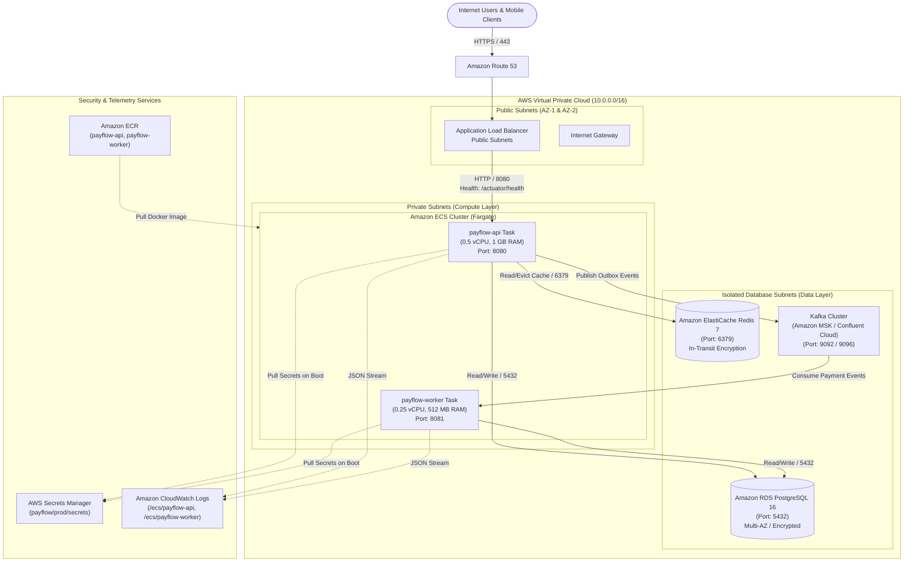

# PayFlow – AWS Cloud Deployment Architecture & Production Guide

## 1. Executive Summary

This guide provides the complete blueprint for deploying **PayFlow – Distributed Payment Processing Engine** to Amazon Web Services (AWS). It details both a high-availability **Enterprise Production Architecture** and an ultra-low-cost **Student / Portfolio Tier** designed to run within the AWS Free Tier or for under \$15-\$25/month.

> [!IMPORTANT]
> **Safety Notice**: In accordance with instructions, no cloud resources have been provisioned or billed. All Terraform configurations, ECS task definitions, CI/CD pipelines, and configuration files have been prepared as executable artifacts ready for deployment upon approval.

---

## 2. AWS Architecture Diagram

The deployment spans two Availability Zones (AZs) following AWS Well-Architected Framework best practices for security and network isolation:



---

## 3. Deployment Configuration (Infrastructure as Code)

Infrastructure as Code is provided in [`deploy/aws/terraform/`](file:///Users/arjunsingh/Documents/paypay%20project%203/deploy/aws/terraform/):

| File | Purpose | Key AWS Resources |
| :--- | :--- | :--- |
| [`main.tf`](file:///Users/arjunsingh/Documents/paypay%20project%203/deploy/aws/terraform/main.tf) | Terraform providers & AWS setup | `aws` provider (v5.40+), region configurations, tags |
| [`variables.tf`](file:///Users/arjunsingh/Documents/paypay%20project%203/deploy/aws/terraform/variables.tf) | Parameterization & cost switches | `portfolio_mode`, CPU/RAM allocations, replica counts |
| [`vpc.tf`](file:///Users/arjunsingh/Documents/paypay%20project%203/deploy/aws/terraform/vpc.tf) | Network topologies across 2 AZs | VPC, 2 Public Subnets, 2 Private Subnets, 2 Database Subnets, IGW, NAT |
| [`security_groups.tf`](file:///Users/arjunsingh/Documents/paypay%20project%203/deploy/aws/terraform/security_groups.tf) | Least-privilege ingress/egress | ALB SG, ECS API SG, ECS Worker SG, RDS SG, Redis SG |
| [`alb.tf`](file:///Users/arjunsingh/Documents/paypay%20project%203/deploy/aws/terraform/alb.tf) | Traffic ingress & routing | Application Load Balancer, Target Group (`/actuator/health`), Listener |
| [`rds.tf`](file:///Users/arjunsingh/Documents/paypay%20project%203/deploy/aws/terraform/rds.tf) | Managed PostgreSQL persistence | RDS PostgreSQL 16 (`db.t4g.micro` or `db.m6g.large`), Subnet Group |
| [`elasticache.tf`](file:///Users/arjunsingh/Documents/paypay%20project%203/deploy/aws/terraform/elasticache.tf) | In-memory balance caching | ElastiCache Redis 7 (`cache.t4g.micro`), TLS, Subnet Group |
| [`ecs.tf`](file:///Users/arjunsingh/Documents/paypay%20project%203/deploy/aws/terraform/ecs.tf) | Container orchestration | ECS Cluster, Task Definitions, Services, ECR Repositories, IAM Roles |
| [`secrets.tf`](file:///Users/arjunsingh/Documents/paypay%20project%203/deploy/aws/terraform/secrets.tf) | Secrets management | AWS Secrets Manager, Random 24-64 char password generation |
| [`cloudwatch.tf`](file:///Users/arjunsingh/Documents/paypay%20project%203/deploy/aws/terraform/cloudwatch.tf) | Centralized log ingestion | CloudWatch Log Groups with retention policies |
| [`outputs.tf`](file:///Users/arjunsingh/Documents/paypay%20project%203/deploy/aws/terraform/outputs.tf) | Deployment endpoint outputs | ALB DNS, Swagger URL, ECR URLs, RDS Endpoint, Secrets ARN |

---

## 4. Environment-Specific Application Configurations

Spring Boot profiles separate local containerized development from AWS cloud production:
- **Local Profile**: Reads plain variables from Docker Compose.
- **Production Profile (`prod`)**: Activated via `SPRING_PROFILES_ACTIVE=prod`.

### Key Production Configurations:
1. **API Service (`application-prod.yml`)**:
   - **PostgreSQL**: Hikari connection pool tuned with `maximum-pool-size: 15`, `minimum-idle: 3`, `leak-detection-threshold: 20000`, `sslmode=require`.
   - **Flyway**: `flyway.enabled: false` inside the long-running API tasks to prevent multi-instance race conditions during rolling restarts.
   - **Redis**: SSL transit encryption enabled (`spring.data.redis.ssl.enabled: true`) with auth token support.
   - **Kafka**: SASL/SCRAM authentication support with configurable JAAS configuration (`KAFKA_SECURITY_PROTOCOL: SASL_SSL`).
   - **Graceful Shutdown**: `server.shutdown: graceful` with 30s timeout per shutdown phase.
2. **Worker Service (`application-prod.yml`)**:
   - Tuned pool size (`maximum-pool-size: 8`).
   - Consumer polling limits: `max.poll.interval.ms: 300000`, `max.poll.records: 50`.

---

## 5. Secure Secrets Management

No database passwords, JWT signing keys, or tokens are ever committed to source control or baked into Docker container images.

```
[ AWS Secrets Manager: payflow/prod/secrets ]
  ├── POSTGRES_USER     -> "payflow_admin"
  ├── POSTGRES_PASSWORD -> "v9#K2x!L8zQp$..." (Random 24 char)
  ├── REDIS_AUTH_TOKEN  -> "d7F1m9P4..." (Random 32 char)
  ├── JWT_SECRET        -> "404E635266556A58..." (Random 64 char)
  └── KAFKA_JAAS_CONFIG -> "org.apache.kafka.common.security.scram..."
                    |
                    v (Injected securely at Task Startup via IAM Role)
  [ ECS Fargate Container Environment: In-Memory Only ]
```

### ECS Task Definition Integration:
In [`deploy/aws/ecs-task-api.json`](file:///Users/arjunsingh/Documents/paypay%20project%203/deploy/aws/ecs-task-api.json), secrets are retrieved at startup by the AWS ECS Agent:
```json
{
  "name": "SPRING_DATASOURCE_PASSWORD",
  "valueFrom": "arn:aws:secretsmanager:us-east-1:123456789012:secret:payflow/prod/secrets:POSTGRES_PASSWORD::"
}
```
The ECS Task Execution Role (`payflow-ecs-execution-role`) has a least-privilege IAM policy strictly granting `secretsmanager:GetSecretValue` on the specific secret ARN.

---

## 6. Database Migration Strategy

### The Multi-Node Concurrency Problem:
In a high-availability ECS deployment with 2 or more API container replicas running in parallel, enabling Flyway auto-migrate inside the web application startup (`flyway.enabled: true`) creates a critical race condition: multiple instances attempt to acquire database migration locks simultaneously, causing deployment timeouts or deadlocks.

### Production Solution:
1. **Isolated One-Shot Migration Task**:
   - Flyway is set to `flyway.enabled: false` in `application-prod.yml`.
   - Before rolling out new API tasks, CI/CD executes a standalone, single-instance ECS Fargate migration task:
     ```bash
     aws ecs run-task \
       --cluster payflow-cluster \
       --task-definition payflow-migration \
       --launch-type FARGATE \
       --network-configuration "awsvpcConfiguration={subnets=[...],securityGroups=[...]}"
     ```
   - Only after the migration task exits with status code `0` does the deployment proceed to update the long-running API tasks.
2. **Expand and Contract Migration Pattern**:
   - **Expand**: Add new columns or nullable fields in migration `V_N`. Deploy application version capable of reading both old and new columns.
   - **Contract**: In the subsequent release `V_N+1`, backfill data and deprecate old columns. Historical double-entry ledger tables remain strictly append-only and protected by the immutability trigger created in `V3`.

---

## 7. Health Checks & Probes

Health checking is implemented at three distinct layers:

### 1. ALB Target Group Health Check:
- **Endpoint**: `GET /actuator/health`
- **Protocol & Port**: HTTP / 8080
- **Thresholds**: Healthy = 2 consecutive passes, Unhealthy = 3 consecutive failures.
- **Interval**: 15 seconds (Timeout: 5s).
- **Match Code**: `200 OK`. Unhealthy targets are removed from the load balancer pool without dropping active in-flight transfers.

### 2. ECS Container Health Check:
- **Command**: `wget -q --spider http://localhost:8080/actuator/health || exit 1`
- **Start Period**: 45 seconds (allows Spring Boot JVM initialization).
- **Failure Action**: If container fails health checks, ECS kills the task and starts a fresh replacement.

### 3. Distributed Infrastructure Diagnostics:
Actuator's [`DistributedInfraHealthIndicator`](file:///Users/arjunsingh/Documents/paypay%20project%203/payflow-api/src/main/java/com/payflow/api/health/DistributedInfraHealthIndicator.java) validates:
- **PostgreSQL**: Connection pool acquisition and query execution latency.
- **Redis**: Command ping and response time.
- **Apache Kafka**: Broker metadata and node cluster connectivity.

---

## 8. CI/CD Deployment Workflow

The automated deployment pipeline is implemented in [`.github/workflows/deploy-aws.yml`](file:///Users/arjunsingh/Documents/paypay%20project%203/.github/workflows/deploy-aws.yml).

### Security Best Practice: Keyless OIDC Authentication
Rather than storing permanent, dangerous `AWS_ACCESS_KEY_ID` and `AWS_SECRET_ACCESS_KEY` credentials in GitHub repository secrets, the workflow uses **OpenID Connect (OIDC)**:
```yaml
- name: Configure AWS Credentials via OIDC
  uses: aws-actions/configure-aws-credentials@v4
  with:
    role-to-assume: ${{ secrets.AWS_ROLE_ARN }}
    aws-region: us-east-1
    audience: sts.amazonaws.com
```
AWS validates GitHub's cryptographic token and issues temporary, 1-hour credentials.

### Deployment Stages:
1. **Quality Gate**: Executes full Maven build and passes all 36 unit and integration tests.
2. **Container Build & Push**: Compiles fat JARs, builds multi-stage Docker images, and pushes them to Amazon ECR tagged with `${{ github.sha }}`.
3. **Database Migration Task**: Runs Flyway migration against Amazon RDS.
4. **ECS Rolling Deployment**: Updates ECS Task Definitions and triggers zero-downtime rolling update.
5. **Post-Deployment Smoke Test**: Performs HTTP validation against the live ALB endpoint.

---

## 9. Rollback Strategy

PayFlow leverages a 3-tier zero-downtime rollback strategy:

### 1. Automated ECS Deployment Circuit Breaker:
Configured in [`deploy/aws/terraform/ecs.tf`](file:///Users/arjunsingh/Documents/paypay%20project%203/deploy/aws/terraform/ecs.tf):
```hcl
deployment_circuit_breaker {
  enable   = true
  rollback = true
}
```
If newly launched containers fail the ALB health check `/actuator/health` or crash on startup, ECS immediately cancels the deployment and rolls back to the previous stable task definition revision without human intervention.

### 2. Instant Manual Rollback via AWS CLI:
If a critical application defect is detected post-deployment:
```bash
# Roll back API service to previous task revision
aws ecs update-service \
  --cluster payflow-cluster \
  --service payflow-api-service \
  --task-definition payflow-api:PREVIOUS_REVISION \
  --force-new-deployment
```

### 3. Graceful Shutdown & Drain:
- When a task is marked for deregistration, ALB deregistration delay (30 seconds) allows existing financial transactions to commit before SIGTERM.
- Spring Boot `server.shutdown: graceful` completes in-flight database transactions before the container exits.

---

## 10. Cost-Conscious Deployment Options

A direct comparison of deployment tiers is provided below:

| Component | Option A: Full Enterprise Production | Option B: Student / Portfolio Tier (`portfolio_mode = true`) |
| :--- | :--- | :--- |
| **Compute (ECS Fargate)** | 2x API (1 vCPU, 2GB) + 2x Worker = **\$88.00 / mo** | 1x API (0.25 vCPU, 512MB) + 1x Worker = **\$9.20 / mo** |
| **Database (RDS)** | `db.m6g.large` Multi-AZ = **\$182.00 / mo** | `db.t4g.micro` Single-AZ = **\$0.00 / mo** (Free Tier eligible: 750 hrs/mo) |
| **In-Memory Cache (Redis)**| `cache.t4g.small` Multi-AZ = **\$46.00 / mo** | `cache.t4g.micro` or Upstash Serverless Redis = **\$0.00 - \$12.00 / mo** |
| **Kafka Broker** | Amazon MSK Serverless / 2x m5.large = **\$160.00 / mo** | Confluent Cloud Free Tier ($0/mo) or ECS-hosted single broker = **\$0.00 - \$6.00 / mo** |
| **Networking (NAT Gateway)**| 2x NAT Gateways = **\$64.80 / mo** | **\$0.00 / mo** (Public IP on Fargate tasks with strict SG rules) |
| **Load Balancer (ALB)** | 1x ALB = **\$16.20 / mo** | 1x ALB = **\$16.20 / mo** |
| **CloudWatch Logs & ECR** | Container Insights + Logs = **\$8.00 / mo** | 7-day retention = **\$0.50 / mo** |
| **TOTAL MONTHLY ESTIMATE** | **~\$565.00 / month** | **~\$15.00 - \$25.00 / month** *(or \$0 for 12 months on new AWS accounts)* |

### Ultra-Low-Cost "Ephemeral Demo Mode":
For technical interviews or portfolio showcases, the infrastructure can be spun up on demand and destroyed immediately after the presentation:
- **Deploy**: `terraform apply -auto-approve` (Takes ~6 minutes).
- **Demonstrate**: Walk through live endpoints, Swagger UI, and Grafana dashboard.
- **Tear Down**: `terraform destroy -auto-approve` (Takes ~4 minutes).
- **Total Cost for a 2-Hour Showcase**: **Less than \$0.35**.

---

## 11. Step-by-Step Deployment Runbook (When Ready)

When you choose to deploy to your AWS account, follow these exact steps:

### Step 1: Set Up AWS CLI Credentials
```bash
aws configure
# Enter your AWS Access Key, Secret Key, and default region (e.g. us-east-1)
```

### Step 2: Initialize & Apply Terraform Infrastructure
```bash
cd deploy/aws/terraform
terraform init
# Review the planned resources
terraform plan -var="portfolio_mode=true"
# Deploy (only when explicitly approved)
terraform apply -var="portfolio_mode=true"
```

### Step 3: Retrieve Outputs & Authenticate Docker to ECR
```bash
ECR_API_URL=$(terraform output -raw ecr_api_repository_url)
ECR_WORKER_URL=$(terraform output -raw ecr_worker_repository_url)
AWS_REGION=$(terraform output -raw aws_region)

aws ecr get-login-password --region $AWS_REGION | docker login --username AWS --password-stdin $ECR_API_URL
```

### Step 4: Build and Push Container Images
```bash
cd ../../..

# Build & Push API Container
docker build -t $ECR_API_URL:latest -f docker/Dockerfile.api .
docker push $ECR_API_URL:latest

# Build & Push Worker Container
docker build -t $ECR_WORKER_URL:latest -f docker/Dockerfile.worker .
docker push $ECR_WORKER_URL:latest
```

### Step 5: Force ECS Service Deployment
```bash
aws ecs update-service --cluster payflow-cluster --service payflow-api-service --force-new-deployment
aws ecs update-service --cluster payflow-cluster --service payflow-worker-service --force-new-deployment
```

### Step 6: Verify Live Deployment
```bash
ALB_URL=$(terraform output -raw alb_dns_name)
curl http://$ALB_URL/actuator/health
# Open Swagger UI in browser:
# http://<ALB_URL>/swagger-ui.html
```
