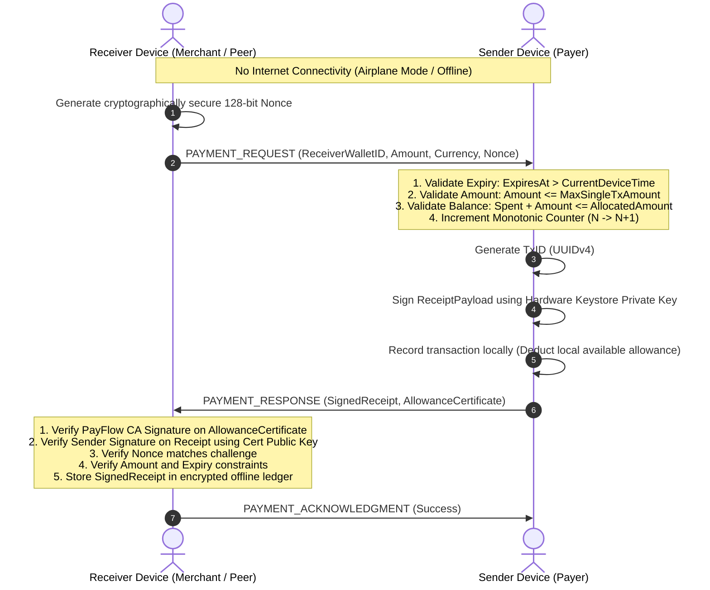
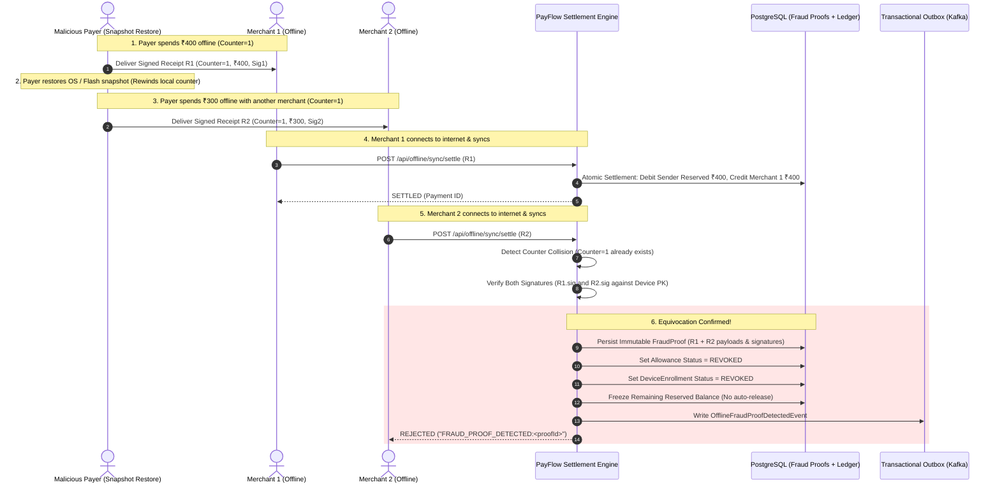
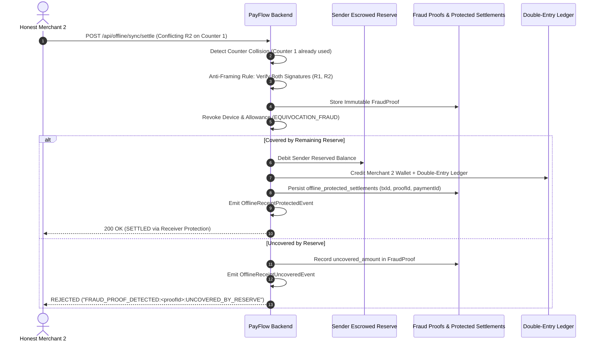

# PayFlow Offline Wallet – Architecture, Cryptography & Threat Model

## 1. Executive Summary & Objective

The **PayFlow Offline Wallet** extends the PayFlow Distributed Payment Processing Engine to enable secure, limited-value peer-to-peer (P2P) payments in environments without internet connectivity (e.g., underground subways, rural transit, remote disaster zones, flights).

Offline payments introduce fundamental distributed systems and security challenges: **without a central authority reachable at the point of sale, how do we prevent double-spending, signature forgery, replay attacks, and balance alteration?**

This document establishes the end-to-end architecture, cryptographic protocols, peer-to-peer transport (NFC/BLE), backend double-entry settlement engine, and an exhaustive threat model detailing hardware vs. software trust assumptions.

---

## 2. System Architecture

```mermaid
flowchart TD
    subgraph OnlinePhase1["Phase 1: Online Allowance Allocation"]
        SenderApp1["Sender Mobile App"] -->|1. POST /api/offline/allowance/allocate\nReserve ₹2,000 for 24h| BackendAPI["PayFlow Spring Boot API"]
        BackendAPI -->|2. Atomically Reserve Balance\nAvailable = ₹8,000, Reserved = ₹2,000| PG[("PostgreSQL\nwallets table")]
        BackendAPI -->|3. Sign Allowance Cert with ECDSA\nPrivate Key| CertSigner["PayFlow Offline Authority"]
        CertSigner -->|4. Return Signed Allowance Certificate| SenderApp1
        SenderApp1 -->|5. Store in Hardware Keystore / TEE| SenderTEE["Encrypted Local Storage"]
    end

    subgraph OfflinePhase2["Phase 2: Offline P2P Payment (NFC / BLE) - Zero Internet"]
        ReceiverApp["Receiver Mobile App"] -->|1. Generate Nonce & Payment Request\n(₹500, Nonce: 0x9a8f, ReceiverWalletID)| SenderApp2["Sender Mobile App"]
        SenderApp2 -->|2. Validate Allowance Balance & Monotonic Counter| LocalValidation["Local Spending Rules Engine"]
        LocalValidation -->|3. Sign with Hardware Private Key| HardwareSigning["Hardware Keystore (TEE / StrongBox)"]
        HardwareSigning -->|4. Signed Transaction Receipt| SenderApp2
        SenderApp2 -->|5. Deliver Receipt + Allowance Cert via NFC/BLE| ReceiverApp
        ReceiverApp -->|6. Verify Cert (PayFlow CA) & Signature (Sender)| ReceiverValidation["Receiver Local Verifier"]
        ReceiverValidation -->|7. Store Signed Receipt Offline| ReceiverStorage["Receiver Local Encrypted Log"]
    end

    subgraph OnlinePhase3["Phase 3: Reconnection, Settlement & Reconciliation"]
        ReceiverApp -->|1. Network Restored: POST /api/offline/sync/settle\nSubmit Signed Receipts| SettlementAPI["Offline Settlement Service"]
        SettlementAPI -->|2. Verify Signatures, Counters, Expiry| CryptoVerifier["Backend Cryptographic Verifier"]
        SettlementAPI -->|3. Atomic Ledger Settlement:\nDebit Sender Reserved, Credit Receiver| DoubleEntry["PostgreSQL Double-Entry Ledger\n(payments + ledger_entries)"]
        SettlementAPI -->|4. Publish Event via Transactional Outbox| Kafka["Apache Kafka\n(payment-events)"]
        BackendAPI -->|5. Allowance Expiry: Release Unspent Reserved Funds| ReleaseWorker["Allowance Reconciler"]
    end
```

---

## 3. Cryptographic Protocol & Data Formats

PayFlow strictly avoids inventing novel cryptographic algorithms. All signatures, certificates, and digests use standardized, FIPS-compliant NIST primitives:
- **Asymmetric Algorithm**: Elliptic Curve Digital Signature Algorithm (**ECDSA**) over the **NIST P-256** (`secp256r1`) curve with **SHA-256**.
- **Hardware Integration**: Android Keystore backed by **Trusted Execution Environment (TEE)** or **StrongBox Keymaster** (FIPS 140-2 Level 3 equivalent).
- **Entropy & Nonces**: Cryptographically secure random 128-bit nonces (`java.security.SecureRandom`).

### A. Device Enrollment Certificate
Before reserving offline allowances, the user's mobile device generates a dedicated EC P-256 keypair inside the hardware Keystore. The public key is transmitted to PayFlow API and stored in `device_enrollments`.

### B. Offline Allowance Certificate Format
When an allowance is allocated, the backend issues an immutable, cryptographically signed certificate:

$$\text{AllowancePayload} = \text{AllowanceID} \,\|\, \text{WalletID} \,\|\, \text{DeviceID} \,\|\, \text{AllocatedAmount} \,\|\, \text{MaxSingleTx} \,\|\, \text{ExpiresAt}$$

$$\text{AllowanceCertificate} = \{\text{AllowancePayload}, \, \sigma_{\text{PayFlowAuthority}} = \text{ECDSA\_Sign}_{SK_{\text{PayFlow}}}(\text{AllowancePayload})\}$$

### C. Signed Offline Transaction Receipt
During an offline peer-to-peer transfer, the sender device signs the specific transaction receipt:

$$\text{ReceiptPayload} = \text{TxID} \,\|\, \text{AllowanceID} \,\|\, \text{SenderWalletID} \,\|\, \text{ReceiverWalletID} \,\|\, \text{Amount} \,\|\, \text{Currency} \,\|\, \text{Counter} \,\|\, \text{Nonce}$$

$$\text{SignedReceipt} = \{\text{ReceiptPayload}, \, \sigma_{\text{SenderDevice}} = \text{ECDSA\_Sign}_{SK_{\text{Device}}}(\text{ReceiptPayload})\}$$

---

## 4. Peer-to-Peer Protocol (NFC & Bluetooth Low Energy)

The offline transaction between two devices executes via a lightweight, binary-encoded, 4-step handshake over **NFC Host Card Emulation (HCE)** or **BLE GATT**:



---

## 5. Settlement & Double-Entry Ledger Accounting

### A. Funds Reservation (Allowance Allocation)
To prevent spending money that does not exist, funds are reserved **online** before entering offline mode:
- User has ₹10,000 available balance in `wallets`.
- User requests ₹2,000 offline allowance for 24 hours.
- Backend executes atomic reservation in PostgreSQL:
  $$\text{balance} = ₹10,000, \quad \text{reserved\_balance} = ₹2,000, \quad \text{available\_balance} = ₹8,000$$
- Online transfers now can only spend up to the ₹8,000 available balance.

### B. Offline Transaction Settlement
When the receiver (or sender) regains internet connection, the batch of signed receipts is submitted to `POST /api/offline/sync/settle`.

For each verified offline receipt:
1. **Idempotency Check**: If `TxID` is already in `offline_transactions`, return original settlement confirmation (prevent duplicate settlement).
2. **Counter Monotonicity**: Ensure `Counter > Allowance.lastCounter` (prevents replay of older counter states).
3. **Cumulative Limit Enforcement**: Ensure `Allowance.spentAmount + Amount <= Allowance.allocatedAmount`.
4. **PostgreSQL Atomic Ledger Execution**:
   - Sender Wallet: `reserved_balance = reserved_balance - Amount`, `balance = balance - Amount`.
   - Receiver Wallet: `balance = balance + Amount`.
   - Ledger Entry 1: `DEBIT` sender wallet for `Amount`.
   - Ledger Entry 2: `CREDIT` receiver wallet for `Amount`.
   - Sum of debits and credits: $\sum \text{Debits} - \sum \text{Credits} = 0$.
   - Transactional Outbox event is emitted (`OfflinePaymentSettledEvent`).

### C. Allowance Expiry & Funds Release
When an allowance expires (e.g., after 24 hours):
- Any unspent reserved balance ($\text{allocated\_amount} - \text{spent\_amount}$) is automatically released back to the sender's available balance:
  $$\text{reserved\_balance} = \text{reserved\_balance} - \text{UnspentAmount}$$
- The allowance status is set to `EXPIRED` or `SETTLED`.
- **Policy on Revoked Allowances**: If an allowance is revoked due to an equivocation fraud proof, remaining reserved funds are **NOT** automatically released. They remain safely escrowed in `reserved_balance` until compliance and dispute administration manually reviews and resolves the incident.

---

## 6. Equivocation Detection & Double-Spend Fraud Proofs

### A. Mathematical Definition of an Equivocation Fraud Proof
In offline peer-to-peer payments, **equivocation** occurs when a single authenticated device signs two conflicting, valid receipts for the exact same transaction counter $C$ within an allowance $A$:

$$\text{FraudProof}(R_1, R_2) \iff \begin{cases}
R_1.\text{allowanceId} = R_2.\text{allowanceId} \\
R_1.\text{counter} = R_2.\text{counter} \\
R_1.\text{payload} \neq R_2.\text{payload} \\
\text{ECDSA\_Verify}(PK_{\text{device}}, R_1.\text{payload}, R_1.\sigma) = \text{true} \\
\text{ECDSA\_Verify}(PK_{\text{device}}, R_2.\text{payload}, R_2.\sigma) = \text{true}
\end{cases}$$

### B. Anti-Framing Security Invariant
> [!IMPORTANT]
> **Anti-Framing Guarantee**: A fraud proof is **NEVER** generated unless BOTH signatures independently verify against the enrolled device's public key.
>
> If a malicious merchant or adversary fabricates a counterfeit receipt claiming to be signed by an innocent payer on counter $C$, the backend verification fails on the counterfeit signature. The submission is rejected as an invalid signature, **no fraud proof is recorded, and the innocent user's device/allowance is never revoked**.

### C. Equivocation Detection & Settlement Sequence



### D. Receiver-Protected Settlement
When an offline double-spend occurs:
1. **First-to-Sync Settlement**: The first valid receipt submitted ($R_1$) settles immediately and is credited to Merchant 1 from the sender's reserved balance. Strict double-entry ledger balance ($\sum \text{Debits} = \sum \text{Credits}$) is preserved.
2. **Receiver Protection from Escrow Reserve**: Rather than rejecting honest merchants, if the second receipt ($R_2$) satisfies:
   - $R_2.\text{amount} \le \text{allowance}.\text{maxSingleTxAmount}$
   - $\text{remainingAllowance} \ge R_2.\text{amount}$
   - $\text{senderWallet}.\text{reservedBalance} \ge R_2.\text{amount}$
   - Receiver wallet is active and currency matches
   - Receipt has not expired
   Then PayFlow executes an atomic settlement under `PROTECTED_BY_RESERVE` mode! The receipt is stored in `offline_protected_settlements`, debited from the sender's escrowed reserve, and credited to Merchant 2. The cheating sender bears the financial cost.
3. **Uncovered Rejection**: If the second receipt exceeds the remaining reserve or limits, it is rejected with reason `FRAUD_PROOF_DETECTED:<proofId>:UNCOVERED_BY_RESERVE`, and the uncovered amount is recorded on the immutable `FraudProof`.
4. **Collateral & Device Containment**:
   - The offending device and allowance are permanently revoked (`revocation_reason = EQUIVOCATION_FRAUD`).
   - Any residual unspent allowance funds remain escrowed in `reserved_balance`.



### E. Grace Settlement for Honest Receivers
Offline payments occur asynchronously without server reachability. An honest merchant may accept a valid, correctly signed payment receipt *before* the cheating sender's device is revoked on the backend.
- **`EQUIVOCATION_FRAUD` Grace Settlement**: Receipts referencing an allowance revoked for equivocation that have a unique, unused counter, are unexpired, and fit within the remaining reserved balance are honored under `GRACE_SETTLEMENT` mode. The receiver acted in good faith; funds were already escrowed.
- **`ADMIN` / `DEVICE_LOST` Strict Rejection**: Receipts referencing devices revoked due to loss or theft are strictly rejected with `"Device reported lost or stolen"` or `"Allowance administratively revoked"`. A lost or compromised device cannot continue spending.
- **Reserve Invariant**: Total settlement never exceeds the sender's reserved balance; negative balances are mathematically impossible.

### F. Reputation-Based Allowance Limits & Anti-Gaming Rules
To dynamically bound offline double-spend risk, offline allowance limits scale based on an explainable, deterministic trust score (`user_reputation`) and an append-only audit trail (`reputation_events`).

#### 1. Reputation Tiers & Configurable Limits
| Tier | Score Range | Max Allowance | Max Single Tx | Purpose |
| :--- | :--- | :--- | :--- | :--- |
| **NEW** | 0 – 199 | ₹500.00 | ₹200.00 | Default tier for newly enrolled users. Low risk exposure. |
| **BRONZE** | 200 – 499 | ₹1,000.00 | ₹300.00 | Established users with proven settlement history. |
| **SILVER** | 500 – 999 | ₹1,500.00 | ₹400.00 | High-trust users with diverse counterparties. |
| **GOLD** | 1000+ | ₹2,000.00 | ₹500.00 | Power users. Bound by global hard ceilings. |
| **RESTRICTED** | N/A | ₹0.00 | ₹0.00 | Fraud-detected or administratively sanctioned users. Cannot request allowances. |

#### 2. Anti-Gaming Protections
- **Wash-Trading Prevention**: Self-dealing between wallets owned by the same user is detected (`senderWallet.getUser().getId().equals(receiverWallet.getUser().getId())`). Wash trades earn **0 points**.
- **Promotion Pre-requisites**: To be promoted above `NEW`, a user must satisfy:
  1. Minimum account age (default: 7 days).
  2. Minimum distinct counterparties (default: 3 unique counterparties across settled transactions).
- **Daily Gain Cap**: Points earned from clean settlements are capped at 50 points per UTC day to prevent velocity spamming.
- **Anti-Thrashing Hysteresis**: A 15-point hysteresis band prevents rapid flapping across tier boundaries (e.g. demotion from BRONZE occurs at 185, not 200).
- **Enforcement at Allocation**: `POST /api/offline/allowance/allocate` verifies reputation tier limits. If the user is RESTRICTED or requests an amount exceeding tier limits, the API returns **HTTP 422 Unprocessable Entity** with an explicit error message showing requested vs limit and tier.
- **Deadlock-Free Lock Ordering**: When updating reputation inside settlements, locks are acquired in canonical order: `allowance row -> wallet rows (UUID order) -> reputation row (locked last)`.

### G. Fraud Alerts, Event Routing & Multi-Channel Delivery
PayFlow incorporates an asynchronous, event-driven notification architecture for rapid incident response when fraud proofs, reputation penalties, or ledger discrepancies are detected.

```
+---------------------------+       Transactional Outbox
|  Settlement / Fraud Proof | ----------------------------+
|  / Reputation Engine      |                             |
+---------------------------+                             v
                                                  Kafka: fraud-alerts
                                                          |
                                                          v
                                              +-----------------------+
                                              |  FraudAlertConsumer   |
                                              |  (Atomic Deduplication|
                                              |   via processed_events|
                                              +-----------------------+
                                                          |
                                                          v
                                              +-----------------------+
                                              |   AlertRuleEngine     |
                                              | (Privacy Masking /    |
                                              |  Severity Assignment) |
                                              +-----------------------+
                                                          |
                                      +-------------------+-------------------+
                                      |                   |                   |
                                      v                   v                   v
                               +--------------+    +--------------+    +--------------+
                               | InAppChannel |    |  LogChannel  |    |WebhookChannel|
                               | (DB Persist) |    |  (Structured |    | (HMAC-SHA256 |
                               |              |    |   JSON Logs) |    |  Slack POST) |
                               +--------------+    +--------------+    +--------------+
```

#### 1. Alert Rule Engine & Severity Tiers
| Trigger Event | Target Recipient | Severity | Privacy Guarantees |
| :--- | :--- | :--- | :--- |
| `OFFLINE_FRAUD_PROOF_DETECTED` | `ROLE_ADMIN` | **CRITICAL** | Full proof details, allowance ID, counter, and conflicting transaction IDs. |
| `OFFLINE_FRAUD_PROOF_DETECTED` | Device Owner | **HIGH** | Masked device ID (`device ***<last4>`); alerts user their allowance was locked. |
| `RECEIVER_PROTECTED_RECEIPT_SETTLED`| Receiver | **INFO** | Sender device ID and public key strictly stripped; confirms protected credit. |
| `OFFLINE_RECEIPT_UNCOVERED` | Receiver | **HIGH** | Informs honest receiver of partial/uncovered settlement without exposing sender keys. |
| `OFFLINE_RECEIPT_UNCOVERED` | `ROLE_ADMIN` | **HIGH** | Audit notice for manual investigation of deficit balance. |
| `REPUTATION_TIER_CHANGED` (RESTRICTED)| User | **HIGH** | Informs user their account was restricted due to detected double-spending. |
| `LEDGER_ROOT_VERIFICATION_FAILED` | `ROLE_ADMIN` | **CRITICAL** | System integrity alert when cryptographic Merkle verification fails. |

#### 2. Pluggable Multi-Channel Delivery
- **In-App Channel**: Stores notifications in the `notifications` table with unique constraint `(event_id, type, recipient_user_id, recipient_role)` preventing duplicate in-app alerts on redelivered events.
- **Log Channel**: Emits structured JSON alerts via SLF4J, tagged with correlation ID, severity, and ref-type.
- **Webhook Channel**: Posts formatted Slack/webhook JSON payloads to configured external endpoint with an `X-PayFlow-Signature: sha256=<hex>` HMAC-SHA256 authentication header. Implements exponential backoff retries with circuit breaker resilience to prevent blocking the worker thread pool.

#### 3. API & Observability
- `GET /api/notifications?unreadOnly=true`: Returns user's in-app notifications.
- `POST /api/notifications/{id}/read`: Idempotently marks a user's notification as read (with strict ownership enforcement).
- `GET /api/admin/alerts`: Filterable by severity, type, and delivery status for administrative audits.
- **Prometheus Metrics**: `alerts_created_total{type, severity}` and `alerts_delivery_failed_total{channel}` integrated into the Grafana Fraud & Alerts dashboard panel.

---

## 7. Threat Model & Security Boundaries

> [!WARNING]
> **Fundamental Theorem of Offline Payments**: In a pure software-only environment running on untrusted client devices, **offline double spending CANNOT be cryptographically prevented with mathematical certainty**. If an adversary has complete root control over device memory and flash storage, they can snapshot the device state, execute an offline payment, restore the snapshot, and execute another offline payment.
>
> However, PayFlow transforms undetected double-spending into **irrefutable cryptographic attribution, immediate automated revocation, and strictly capped loss exposure**.

### Threat Matrix & Mitigations

| Threat | Attack Vector | Security Boundary | Mitigation & Defense-in-Depth |
| :--- | :--- | :--- | :--- |
| **Replay Attack** | Malicious actor captures valid offline receipt and submits it twice to backend API. | Protocol / Backend | **Cryptographic Nonce + Unique TxID**: Backend database unique constraint on `offline_transactions(id)` and `(allowance_id, counter)`. Identical submissions return `ALREADY_SETTLED` idempotently. |
| **Double Spending (Software Equivocation)** | Rooted Android device restores flash snapshot or freezes memory to reuse local balance. | Client / OS / Settlement | **Equivocation Detection + Fraud Proofs + Auto-Revocation**: Conflicting signed receipts on the same counter generate an immutable cryptographic `FraudProof`, immediately revoking the device and freezing remaining allowance funds. **Hardware TEE / StrongBox** provides physical defense. Financial caps (e.g. ₹2,000 max, 24h TTL) strictly bound residual loss exposure. |
| **Allowance Overspending** | Attacker modifies local client database to report higher offline allowance. | Cryptographic | **PayFlow Authority Signature**: Receiver verifies backend's ECDSA signature over the allowance certificate. Forging the allowance requires breaking secp256r1. |
| **Counter Manipulation** | Skipping or rewinding transaction counter sequence. | Cryptographic / Protocol | **Strict Monotonic Sequence**: Receiver and backend verify that `counter` strictly increments. Gaps trigger an audit alert; decrements are rejected. |
| **Receiver Collusion (Framing)** | Receiver fabricates receipt claiming sender transferred funds. | Cryptographic | **Anti-Framing Invariant**: Every transaction requires sender's private key signature. The backend never records a fraud proof unless both signatures independently verify under the sender's public key. |
| **Network Interruption during Sync** | Connection drops midway through uploading batch of 10 receipts. | Backend Transaction | **Idempotent Batch Settlement**: Each transaction is processed in its own savepoint or batch transaction. Re-submitting the batch safely settles remaining items and replays completed ones. |
| **Device Compromise / Theft** | Stolen phone used to make offline purchases. | Device Security | **Biometric Authentication (Android BiometricPrompt)** required before Keystore unlocks signing key for amounts exceeding threshold; device revocation via `POST /api/offline/devices/revoke`. |
